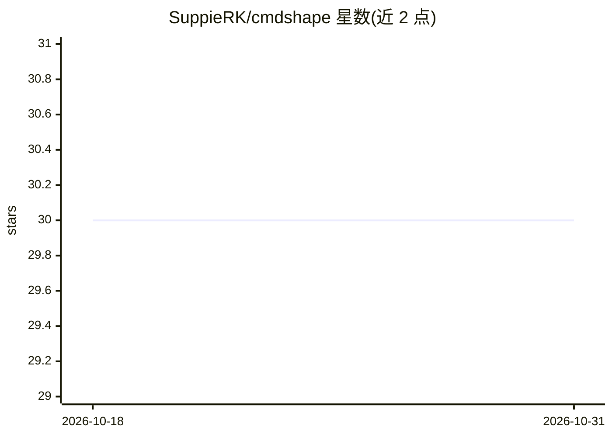

# SuppieRK/cmdshape

⭐ 30 · Go · MIT · 推送 2026-10-24 · [GitHub](https://github.com/SuppieRK/cmdshape) · [官网](https://suppierk.github.io/cmdshape/) · 个人维护

**给编码代理的命令输出过滤代理，去除已知 CLI 噪音**

cmdshape 是包裹在既有 CLI 命令外的小型代理：执行原生程序并保留退出码，对匹配的命令应用确定性的 YAML 过滤规则，剔除已知噪音但保留可行动的诊断与失败上下文；无法识别安全形态时保守透传，并始终提供 --raw 获取原生输出。面向使用编码代理（Claude Code、Codex、Cursor 等）的开发者，通过 cmdshape init 安装钩子/插件/指令文件集成，内置覆盖 git、npm、go、docker 等约 60 种命令的过滤器，支持项目级自定义过滤器（需经 trust 审核流程）。以 shell 安装脚本下载发布二进制安装，macOS 二进制未做 Apple 签名公证。

## 筛选速览

| 维度 | 判定 | 备注 |
|---|---|---|
| AI 角色 | `ai-ecosystem` | LLM/agent 周边工具 |
| 许可风险 | `permissive` | MIT |
| 部署形态 | `desktop` | 安装包/桌面程序 |
| 模型依赖 | — | README 未给出锁定关系 |
| 硬件要求 | — | 无带数字的原话,不猜 |
| 安装摩擦 | `low` | 无编译、无系统依赖或容器化 |
| 成熟度 | — | 结构信号不足 |

## 能力要点

- 确定性 YAML 过滤规则，保留退出码与可行动诊断，--raw 随时可取原生输出
- cmdshape init 自动为 Claude Code、Codex、OpenCode 等代理安装钩子/插件/指令文件
- 内置覆盖 git/npm/go/docker/terraform 等约 60 种命令族的过滤器
- cmdshape gain 度量输出边界上的字节削减，项目级过滤器需 trust 审核后生效

## 适用场景

- 让编码代理的上下文少受 git/npm 等命令冗余输出的干扰
- 为仓库自定义脚本编写项目级输出过滤规则并审核生效
- 查看命令输出在 cmdshape 边界上的削减统计

## 场景标签

 · 领域:开发者工具/编码代理基础设施

## 证据(README 行号)

> L14: `cmdshape` is command-output control for coding agents. Deterministic filters
> L88: `cmdshape init` detects supported coding-agent integrations and installs or

## 星数曲线

2026-10-18 30 → 2026-10-31 30（+0）

---
*卡片 v1 · prompt 1.4 · 生成 2026-10-26 · 置信度 high · 依据 README sha `8664f1fcea7f` · [字段定义](../../DATASET.md)*
