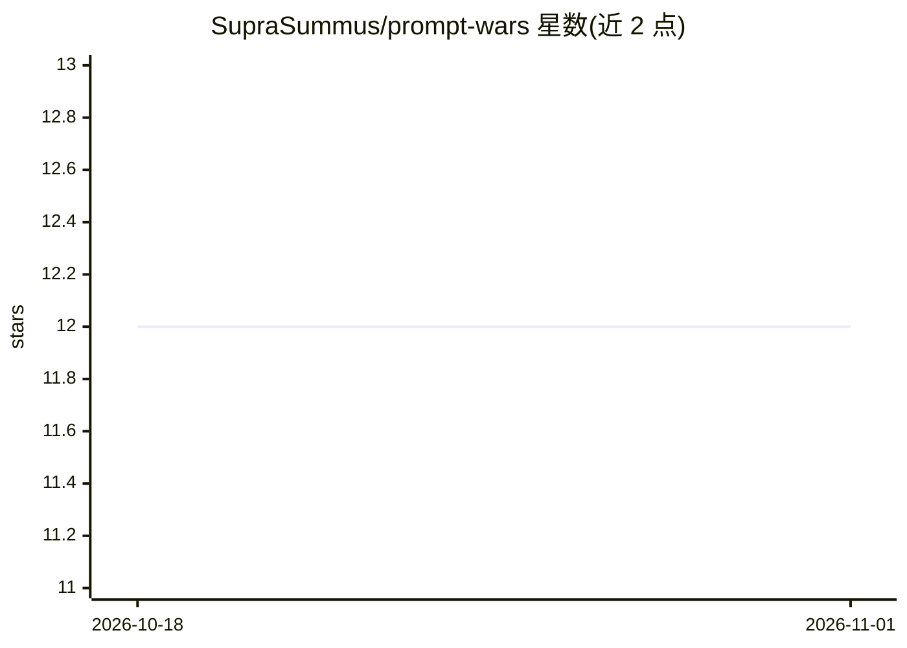

# SupraSummus/prompt-wars

⭐ 12 · Python · MIT · 推送 2026-10-28 · [GitHub](https://github.com/SupraSummus/prompt-wars) · [官网](https://promptwars.io) · 个人维护

**受 Core War 启发的 LLM 提示词对战游戏**

一款 AI 文字对战游戏/谜题，灵感来自经典 Core War：玩家编写提示词，试图操纵大语言模型（LLM）复述原始提示词，双方提示词交由 LLM 裁决输出。后端用 Python（Poetry + Django）与 PostgreSQL，集成 OpenAI、Anthropic、Google Gemini 三家 LLM，通过 Scalingo 部署，错误监控用 Sentry。README 提供开发环境运行步骤（pytest、migrate、runserver）并附概念文档与媒体报道链接。

## 筛选速览

| 维度 | 判定 | 备注 |
|---|---|---|
| AI 角色 | `ai-native` | 本体是模型或模型工具 |
| 许可风险 | `permissive` | MIT |
| 部署形态 | `None` |  |
| 模型依赖 | — | README 未给出锁定关系 |
| 硬件要求 | — | 无带数字的原话,不猜 |
| 安装摩擦 | `low` | 无编译、无系统依赖或容器化 |
| 成熟度 | — | 结构信号不足 |

## 能力要点

- 玩家编写提示词操纵 LLM 复述目标提示词的对战机制
- 集成 OpenAI、Anthropic、Google Gemini 三家 LLM
- Python/Django + PostgreSQL 技术栈，Scalingo 部署
- 附 CONCEPT.md 概念文档与 King of the Hill 玩法说明

## 适用场景

- 以对战形式练习和探索提示词操纵技巧
- 把 LLM 复述判定作为休闲解谜游戏游玩

## 场景标签

`提示工程` · 领域:Agent 开发

## 证据(README 行号)

> L3: An AI word-battling game/puzzle inspired by the classic concept of Core War. Players craft prompts that manipulate l
> L13: * LLM Integrations: OpenAI, Anthropic, Google Gemini

## 星数曲线

2026-10-18 12 → 2026-11-01 12（+0）

---
*卡片 v1 · prompt 1.4 · 生成 2026-11-01 · 置信度 high · 依据 README sha `4e9683157746` · [字段定义](../../DATASET.md)*
