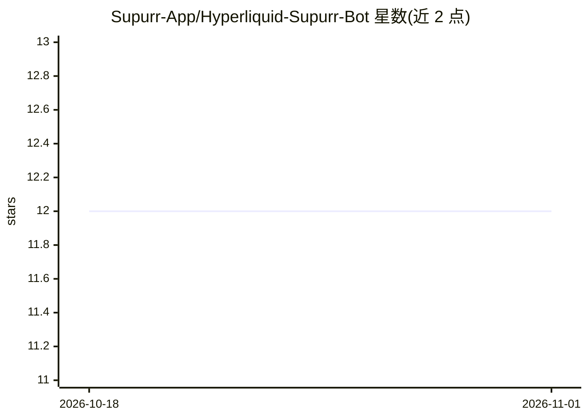

# Supurr-App/Hyperliquid-Supurr-Bot

⭐ 12 · Rust · 推送 2026-05-28 · [GitHub](https://github.com/Supurr-App/Hyperliquid-Supurr-Bot) · [官网](https://supurr.app) · 组织维护

**面向 Hyperliquid 的 Rust 开源交易机器人引擎**

用 Rust 编写的单一二进制交易机器人引擎，专为 Hyperliquid 永续/现货/HIP-3/预测市场构建，约 24K 行代码、9 个 crate。策略通过统一 Exchange trait 在实盘/纸面/回测三种模式下运行同一代码路径；内置 Grid、DCA、做市、期现套利、Tick 五种策略，并支持实现 Strategy trait 自定义。提供 CLI 工具完成配置生成、回测、部署与监控，另提供可将 AI 编程助手转变为机器人操作者的 Supurr Skill（npx 安装），支持 20+ AI agent。需要 Rust 1.75+ 与 Hyperliquid API wallet。

## 筛选速览

| 维度 | 判定 | 备注 |
|---|---|---|
| AI 角色 | `ai-enhanced` | 去掉 AI 部分产品仍成立 |
| 许可风险 | `none` | — |
| 部署形态 | `library` | 以包/库形式分发 |
| 模型依赖 | — | README 未给出锁定关系 |
| 硬件要求 | — | 无带数字的原话,不猜 |
| 安装摩擦 | `low` | 无编译、无系统依赖或容器化 |
| 成熟度 | — | 结构信号不足 |

## 能力要点

- Live/Paper/Backtest 三模式共享统一 Exchange trait，同一策略代码
- 编译为单一二进制，HTTP-only 适配器含退避与健康门控
- 内置 5 种策略（Grid/DCA/做市/期现套利/Tick）覆盖 Perp、Spot、HIP-3、Outcome 市场
- 引擎可编译到 WASM 在浏览器中回测

## 适用场景

- 在 Hyperliquid 上跑网格、DCA 或做市策略并实盘交易
- 用真实行情价格做零风险纸面交易验证策略
- 通过自然语言让 AI 编程助手完成机器人配置、回测与部署
- 对预测市场（Yes/No 事件市场）运行量化策略

## 场景标签

`金融量化` · 领域:学习与行业

## 证据(README 行号)

> L3:  The Open-Source Trading Bot Engine for Hyperliquid
> L240: The **Hyperliquid Supurr Skill** turns your AI coding assistant into a trading bot operator. Config generation, ba
> L244: npx skills add Supurr-App/Hyperliquid-Supurr-Skill

## 星数曲线

2026-10-18 12 → 2026-11-01 12（+0）

---
*卡片 v1 · prompt 1.4 · 生成 2026-11-01 · 置信度 mid · 依据 README sha `7230ef1e0be6` · [字段定义](../../DATASET.md)*
