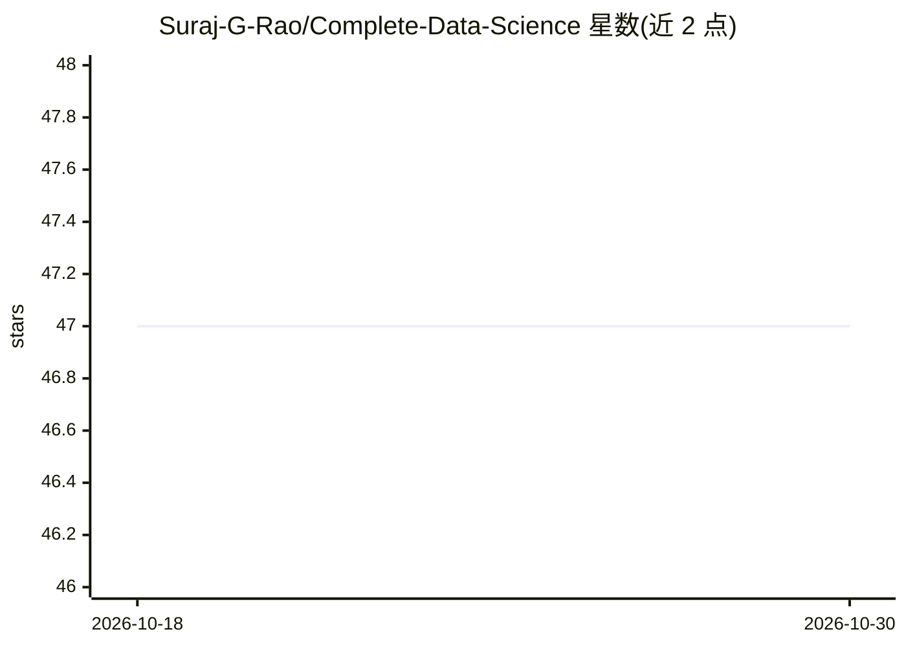

# Suraj-G-Rao/Complete-Data-Science

⭐ 47 · Jupyter Notebook · MIT · 推送 2026-09-20 · [GitHub](https://github.com/Suraj-G-Rao/Complete-Data-Science) · 个人维护

**跟随 Udemy 课程的数据科学学习代码集合：ML/DL/NLP/MLOps**

个人学习仓库，按 Krish Naik 的 Udemy 数据科学课程顺序组织实现代码与项目：覆盖 Python 基础、EDA、特征工程、监督/无监督机器学习算法、深度学习（RNN/LSTM/Transformers）、NLP、MLOps（MLflow、BentoML、Docker）与密码学。仓库按编号目录（0-Introduction、1-PYTHON 等）组织模块，技术栈包括 Python、SQL、TensorFlow、Keras、PyTorch、Scikit-learn。README 未提供安装或运行说明，声明仅供教育用途、为个人学习记录。

## 筛选速览

| 维度 | 判定 | 备注 |
|---|---|---|
| AI 角色 | `ai-knowledge` | 知识聚合/清单类 |
| 许可风险 | `permissive` | MIT |
| 部署形态 | `None` |  |
| 模型依赖 | — | README 未给出锁定关系 |
| 硬件要求 | — | 无带数字的原话,不猜 |
| 安装摩擦 | `low` | 无编译、无系统依赖或容器化 |
| 成熟度 | — | 结构信号不足 |

## 能力要点

- 按课程模块编号组织的目录结构
- 覆盖监督/无监督算法、深度学习与 NLP 实现清单
- 涉及 MLflow、BentoML、Docker 等 MLOps 工具

## 适用场景

- 跟随课程路线查找各算法的参考实现
- 了解数据科学端到端项目的模块组织方式

## 场景标签

`教程课程` · 领域:学习与行业

## 证据(README 行号)

> L3: A comprehensive collection of data science projects and implementations following Krish Naik's Udemy course. This re
> L7: This repository contains implementations and projects based on **Krish Naik's Data Science Udemy Course** - one of t
> L99: This repository represents a systematic learning journey through data science, starting from basic Python programmi

## 星数曲线

2026-10-18 47 → 2026-10-30 47（+0）

---
*卡片 v1 · prompt 1.4 · 生成 2026-10-25 · 置信度 high · 依据 README sha `15af48bc6a10` · [字段定义](../../DATASET.md)*
