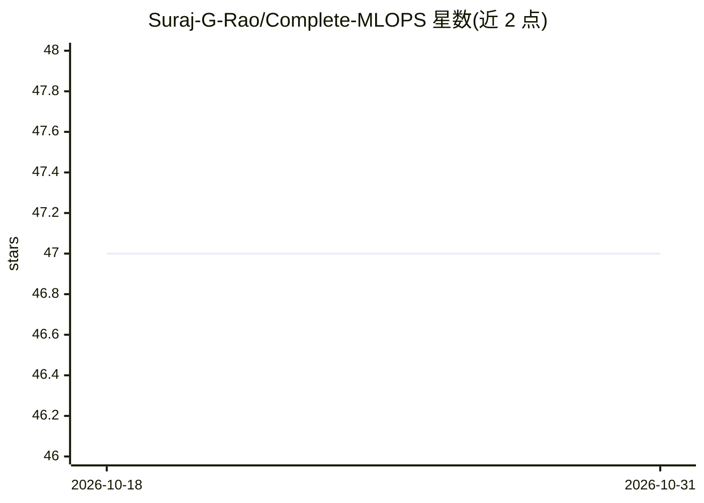

# Suraj-G-Rao/Complete-MLOPS

⭐ 47 · Jupyter Notebook · MIT · 推送 2026-09-20 · [GitHub](https://github.com/Suraj-G-Rao/Complete-MLOPS) · 个人维护

**MLOps 学习仓库：10+ 个覆盖 ML 全生命周期的教学项目**

跟随 Krish Naik 在 Udemy 的 Complete MLOps Bootcamp 课程整理的代码仓库，含 17 个模块：MLflow 实验追踪、DVC 数据版本控制、Dagshub 集成、Docker 容器化、Apache Airflow 编排、GitHub Actions CI/CD、AWS SageMaker 部署、Grafana 监控以及 LLMmOps 等，另含网络安全、NLP 文本摘要等端到端项目。每个模块有独立 README、配置文件与 src 目录，通过 git clone 后 pip 安装依赖运行。仓库声明仅用于教育目的。

## 筛选速览

| 维度 | 判定 | 备注 |
|---|---|---|
| AI 角色 | `ai-knowledge` | 知识聚合/清单类 |
| 许可风险 | `permissive` | MIT |
| 部署形态 | `library` | 以包/库形式分发 |
| 模型依赖 | — | README 未给出锁定关系 |
| 硬件要求 | — | 无带数字的原话,不猜 |
| 安装摩擦 | `low` | 无编译、无系统依赖或容器化 |
| 成熟度 | — | 结构信号不足 |

## 能力要点

- 17 个模块覆盖实验追踪、数据版本控制、容器化、CI/CD 与监控
- 包含网络安全与 NLP 文本摘要等端到端项目
- 各模块遵循统一结构（config.yaml/src/research/templates）
- MIT 许可，声明仅供教育用途

## 适用场景

- 系统学习 MLOps 从开发到部署监控的完整流程
- 参考端到端 ML 项目模板搭建自己的流水线
- 实践 MLflow、DVC、Airflow、Docker 等工具的组合使用

## 场景标签

`教程课程` `MLOps` · 领域:学习与行业

## 证据(README 行号)

> L3: A comprehensive repository containing 10+ end-to-end Machine Learning projects following the Complete MLOps Bootcamp
> L184: **Note**: This repository is for educational purposes. Please ensure you have the necessary permissions and licens

## 星数曲线

2026-10-18 47 → 2026-10-31 47（+0）

---
*卡片 v1 · prompt 1.4 · 生成 2026-10-25 · 置信度 mid · 依据 README sha `3158a5b34cde` · [字段定义](../../DATASET.md)*
