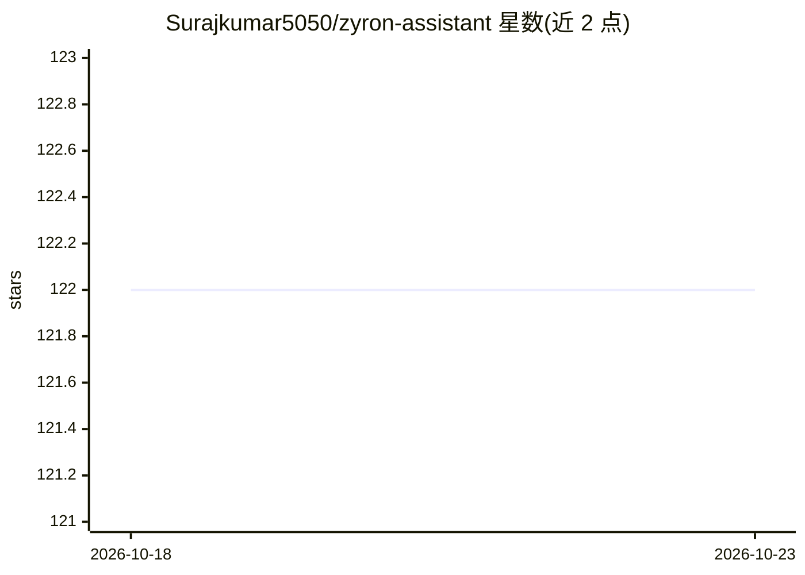

# Surajkumar5050/zyron-assistant

⭐ 122 · Python · MIT · 推送 2026-03-10 · [GitHub](https://github.com/Surajkumar5050/zyron-assistant) · 个人维护

**Windows 本地 AI 桌面助手：语音/Telegram 远程控制电脑**

面向 Windows 用户的本地化 AI 桌面助手，通过 Ollama 运行 Qwen 2.5 Coder 模型（可换任何 Ollama 兼容模型），以语音唤醒词或 Telegram 机器人远程操控电脑：应用/电源/窗口管理、文件搜索（30 天访问历史、自然语言查找）、系统监控、截屏/摄像头/录音并经 Telegram 传输、Firefox 浏览器桥接扩展。全部处理在本地进行，无需云端 API。安装需先装 Ollama 并拉取模型，再 git clone 后运行 setup.bat；当前仅支持 Windows，闲置内存占用 2-4 GB。

## 筛选速览

| 维度 | 判定 | 备注 |
|---|---|---|
| AI 角色 | `ai-native` | 本体是模型或模型工具 |
| 许可风险 | `permissive` | MIT |
| 部署形态 | `library` | 以包/库形式分发 |
| 模型依赖 | local-ok | 支持本地模型 |
| 硬件要求 | — | 无带数字的原话,不猜 |
| 安装摩擦 | `low` | 无编译、无系统依赖或容器化 |
| 成熟度 | — | 结构信号不足 |

## 能力要点

- 语音唤醒词 + Telegram 远程双通道控制 Windows PC
- 基于 Ollama 本地模型（默认 qwen2.5-coder:7b），无云端依赖
- 自然语言文件搜索：30 天文件访问历史、40+ 文件类型
- Firefox 扩展桥接实现浏览器活动监控与标签页控制

## 适用场景

- 出差时通过 Telegram 远程操作家里/办公室的 Windows 电脑
- 用语音命令打开应用、查电量、截屏而不碰键盘鼠标
- 找回'昨天下午看过的那个 PDF'等近期打开过的文件
- 监控并清理闲置高内存的后台进程

## 场景标签

 · 领域:桌面自动化/AI 助手

## 证据(README 行号)

> L15:  Control your Windows PC with voice commands or Telegram - all powered by local AI with zero cloud dependencies
> L30:  Powered by Qwen 2.5 Coder - understands context and intent
> L97: 1. **Download Ollama**: Visit ollama.com and install it.

## 星数曲线

2026-10-18 122 → 2026-10-23 122（+0）

---
*卡片 v1 · prompt 1.4 · 生成 2026-10-23 · 置信度 high · 依据 README sha `6bc5fcd4e4d9` · [字段定义](../../DATASET.md)*
