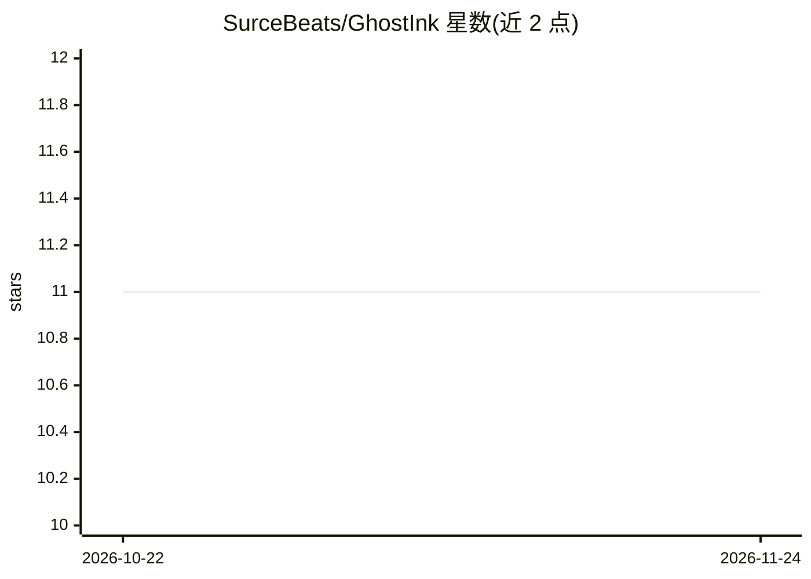

# SurceBeats/GhostInk

⭐ 11 · JavaScript · AGPL-3.0 · 推送 2026-04-09 · [GitHub](https://github.com/SurceBeats/GhostInk) · [官网](https://www.homedock.cloud/apps/ghostink/) · 个人维护

**把秘密文本隐藏进 emoji 的 Unicode 隐写工具**

基于 Unicode Tag Characters（U+E0001–U+E007F）的 emoji 隐写工具：将消息字符逐一映射为不可见标签字符并附加到 emoji 后，肉眼与原 emoji 无差异；支持编码、解码、带标签保存已编码 emoji、码点分析、重音字符归一化与示例演示，并附教学章节说明各平台对标签字符的保留情况。Web 应用形态，Flask + React 栈，提供 Docker Compose 与 HomeDock OS 应用商店两种部署方式，含单用户登录与 bcrypt 等安全机制，AGPL-3.0 许可。

## 筛选速览

| 维度 | 判定 | 备注 |
|---|---|---|
| AI 角色 | `ai-enhanced` | 去掉 AI 部分产品仍成立 |
| 许可风险 | `viral` | AGPL-3.0 |
| 部署形态 | `self-host` | docker 或自建部署 |
| 模型依赖 | — | README 未给出锁定关系 |
| 硬件要求 | — | 无带数字的原话,不猜 |
| 安装摩擦 | `low` | 无编译、无系统依赖或容器化 |
| 成熟度 | — | 结构信号不足 |

## 能力要点

- 用 Unicode Tag Characters 实现完全不可见的数据隐藏
- 解码面板支持粘贴任意 emoji 提取隐藏文本并做码点分析
- 列出 Twitter/X、Signal、WhatsApp 等平台对标签字符的保留/剥离情况
- Docker Compose 一键部署，数据持久化到本地卷

## 适用场景

- 在社交平台通过 emoji 传递不可见的秘密信息
- 检测粘贴的 emoji 中是否藏有隐藏文本
- 学习 Unicode 标签字符的隐写原理

## 场景标签

 · 领域:信息安全/隐写工具

## 证据(README 行号)

> L7: Emoji steganography tool that hides secret text inside emojis using Unicode Tag Characters (U+E0001–U+E007F). The hi
> L17: GhostInk maps each character of your secret message to its corresponding tag character and appends them after any v

## 星数曲线

2026-10-22 11 → 2026-11-24 11（+0）

---
*卡片 v1 · prompt 1.4 · 生成 2026-11-18 · 置信度 low · 依据 README sha `a9d50ea55647` · [字段定义](../../DATASET.md)*
