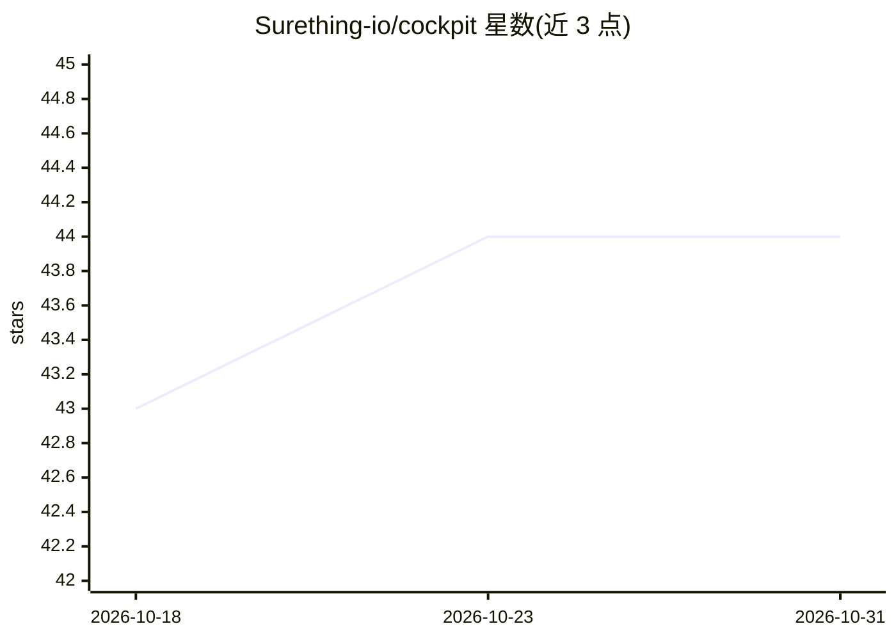

# Surething-io/cockpit

⭐ 44 · TypeScript · MIT · 推送 2026-10-30 · [GitHub](https://github.com/Surething-io/cockpit) · [官网](https://opencockpit.dev) · 组织维护 · 中文 README

**开源的通用 Claude Code GUI/IDE，多引擎多项目并行的 AI 编码工作台**

基于官方 Claude Agent SDK 构建的本地优先 Web 客户端-服务器 IDE 类工作台：多项目并行 agent 会话、6 种引擎并排开标签（Claude/Codex/DeepSeek/GLM/Kimi/本地 Ollama，各自独立会话）。提供内置终端、可被 agent 驱动的 Chrome/PostgreSQL/MySQL/Redis 气泡、行级代码评注与回传 AI 修复、8 种斜杠模式、持久化子代理 Bots、定时任务与 SKILL.md 扩展。npm 全局安装，需 Node ≥ 20；可自托管在共享开发机上供团队各占一席。API key 存本地，无遥测。

## 筛选速览

| 维度 | 判定 | 备注 |
|---|---|---|
| AI 角色 | `ai-ecosystem` | LLM/agent 周边工具 |
| 许可风险 | `permissive` | MIT |
| 部署形态 | `library` | 以包/库形式分发 |
| 模型依赖 | local-ok | 支持本地模型 |
| 硬件要求 | — | 无带数字的原话,不猜 |
| 安装摩擦 | `low` | 无编译、无系统依赖或容器化 |
| 成熟度 | — | 结构信号不足 |

## 能力要点

- 6 引擎并排标签（Claude/Codex/DeepSeek/GLM/Kimi/Ollama），BYOK
- Smart Bubbles：agent 可驱动 Chrome、PostgreSQL、MySQL、Redis
- Code Map/CodeGraph：基于 tree-sitter 的调用图导航与 10 个 HTTP 代码图端点
- 每个工具调用的磁盘变更快照（shadow git，本地 7 天历史）

## 适用场景

- 多个仓库并行跑 AI 重构/测试/排查且随时切换查看
- 团队在共享开发机自托管，各自浏览器开自己的 AI 会话
- 让 agent 操作浏览器和数据库执行 nightly UI 冒烟等定时任务
- 用行级评注把审阅意见回传 AI 自动修复

## 场景标签

`编码 Agent` `代码审查` `浏览器自动化` · 领域:效率与自动化

## 证据(README 行号)

> L19: > **OpenCockpit is the open Claude Code GUI for any LLM** — an IDE-like workbench for the whole dev loop. Run multi
> L31: Cockpit is the instrument panel. It does **not** replace Claude Code; it stands on top of the official Agent SDK an
> L87: - Default engine powered by the **official Claude Agent SDK** — zero extra setup

## 星数曲线

2026-10-18 43 → 2026-10-31 44（+1）

---
*卡片 v1 · prompt 1.4 · 生成 2026-10-25 · 置信度 high · 依据 README sha `e75ea0717287` · [字段定义](../../DATASET.md)*
