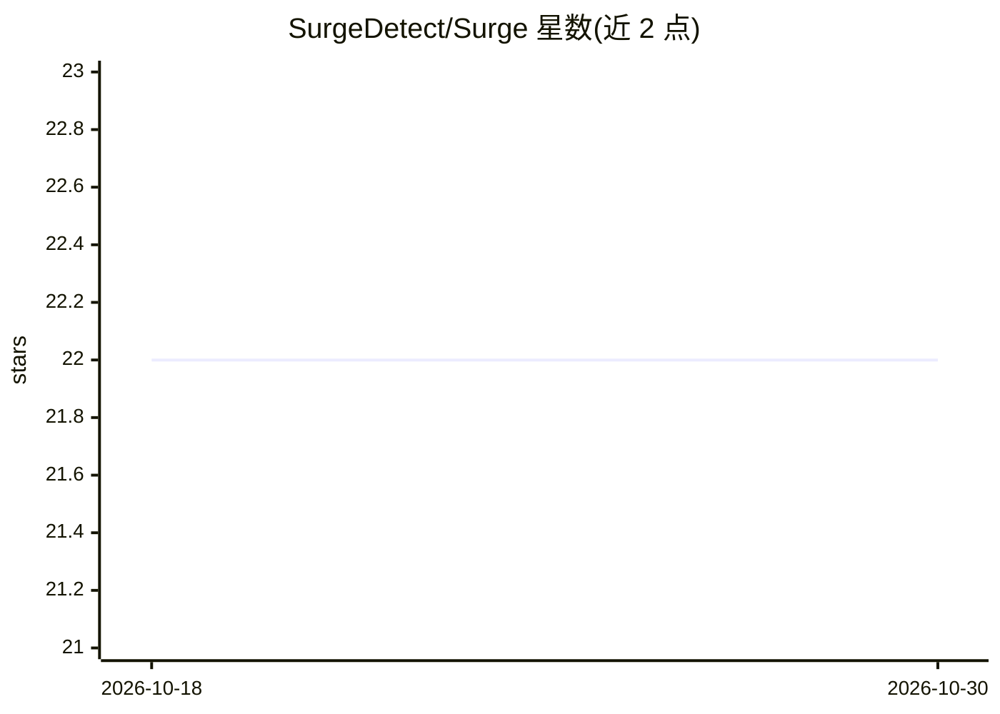

# SurgeDetect/Surge

⭐ 22 · TypeScript · MIT · 推送 2026-09-04 · [GitHub](https://github.com/SurgeDetect/Surge) · [官网](https://surgedetect.com/) · 组织维护

**Robinhood 加密货币突破质量过滤器：四维评分排序行情**

面向 Robinhood 加密货币交易者的突破质量过滤工具：拉取行情快照后，按参与度加速、报价深度增长、回补质量与订单分散度四个正项组件加集中度惩罚计算综合分，经决策门过滤后输出 PROMOTE/WATCH/SCAN/REJECT 分级榜单。每条被拒候选记录失败门，告警仅在决策实质变化时触发。README 明确快照固定于时间戳、不将存储数据标记为实时。TypeScript 实现，含示例输出票据。

## 筛选速览

| 维度 | 判定 | 备注 |
|---|---|---|
| AI 角色 | `ai-enhanced` | 去掉 AI 部分产品仍成立 |
| 许可风险 | `permissive` | MIT |
| 部署形态 | `library` | 以包/库形式分发 |
| 模型依赖 | — | README 未给出锁定关系 |
| 硬件要求 | — | 无带数字的原话,不猜 |
| 安装摩擦 | `low` | 无编译、无系统依赖或容器化 |
| 成熟度 | — | 结构信号不足 |

## 能力要点

- 四组件评分：参与度+深度增长+回补质量+订单分散度−集中度惩罚
- 四道决策门过滤，拒绝候选记录失败原因
- 输出 PROMOTE/WATCH/SCAN/REJECT 分级与组件分
- 告警抑制机制：仅在决策实质变化时提醒

## 适用场景

- 区分可持续的 Robinhood 加密突破与短暂尖峰
- 过滤弱参与的虚假大阳线行情
- 按综合质量分排序候选突破标的

## 场景标签

 · 领域:金融交易/加密货币

## 证据(README 行号)

> L5: **Robinhood crypto breakout-quality filter.**
> L35: - `Primary inputs` — participation acceleration, quoted-depth growth, refill quality, and order dispersion
> L62: score = participation + depth growth + refill quality + order dispersion - concentration penalty

## 星数曲线

2026-10-18 22 → 2026-10-30 22（+0）

---
*卡片 v1 · prompt 1.4 · 生成 2026-10-27 · 置信度 mid · 依据 README sha `8944ff22768a` · [字段定义](../../DATASET.md)*
