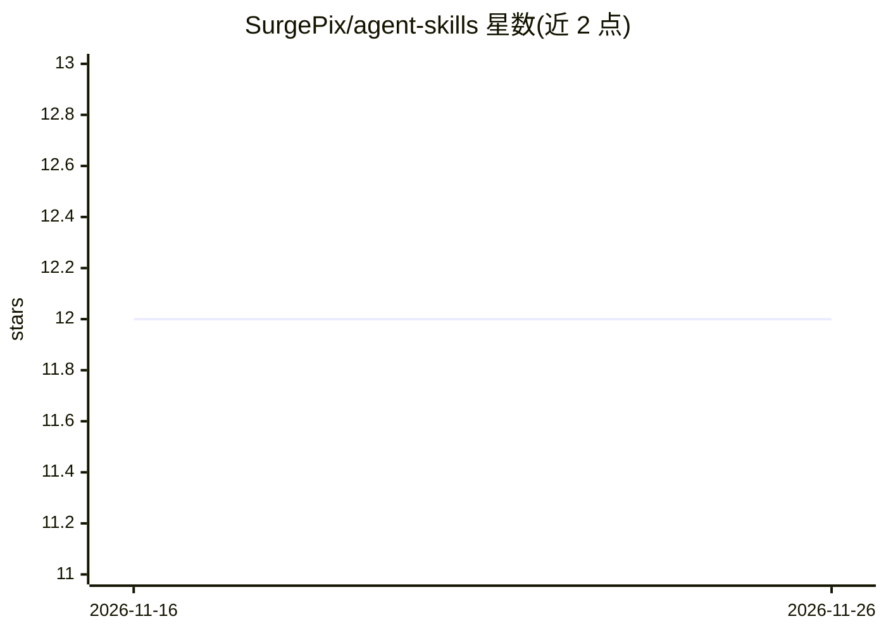

# SurgePix/agent-skills

⭐ 12 · JavaScript · MIT · 推送 2026-10-28 · [GitHub](https://github.com/SurgePix/agent-skills) · [官网](https://surgepix.ai/) · 组织维护 · 中文 README

**为 AI agent 提供图像处理技能：抠图、生成海报/PPT、翻译图片**

SurgePix 的官方 Agent Skills 仓库，将 SurgePix 图像处理 API 封装为 SKILL.md 格式的可组合技能，供 Claude Code、Codex CLI、Cursor、Gemini CLI、OpenClaw 等 agent 环境调用。技能覆盖去背景、生成海报/logo/PPT/故事板/插图/小红书套图、图片与 PPT 翻译、局部重绘等，输出透明 PNG、PPTX、ZIP 等文件；支持会话式迭代与异步任务查询。使用需在 surgepix.ai 获取 API key 并设置环境变量，脚本以 Node 运行，每次技能调用将 prompt 或图片数据交由云端 API 处理。

## 筛选速览

| 维度 | 判定 | 备注 |
|---|---|---|
| AI 角色 | `ai-native` | 本体是模型或模型工具 |
| 许可风险 | `permissive` | MIT |
| 部署形态 | `library` | 以包/库形式分发 |
| 模型依赖 | — | README 未给出锁定关系 |
| 硬件要求 | — | 无带数字的原话,不猜 |
| 安装摩擦 | `low` | 无编译、无系统依赖或容器化 |
| 成熟度 | — | 结构信号不足 |

## 能力要点

- 14 个技能以 SKILL.md 标准供各 agent 平台调用
- 去背景输出透明 PNG，PPT 生成保留可编辑 .pptx 格式
- 异步任务提交与轮询（--nowait / query-task 技能）
- 按用户会话语言控制生成图内文字的语种

## 适用场景

- 电商商品图批量去背景生成目录素材
- 让 agent 用一句指令生成活动海报或品牌 logo 概念图
- 把英文 PPT 保留版式翻译成其他语言
- 串联上传→抠图→下载的自动化 agent 流水线

## 场景标签

`图像视频处理` `图像生成` · 领域:内容生成

## 证据(README 行号)

> L4: SurgePix is an AI image processing platform that lets you remove backgrounds, upload files, and automate image workf
> L79: The SurgePix Agent Skills give AI agents (Claude, Codex, Cursor, Gemini, OpenClaw, and similar agentic systems) str
> L161: **Requirement:** Set `SURGEPIX_API_KEY` and `SURGEPIX_BASE_URL`. Get your key at surgepix.ai.

## 星数曲线

2026-11-16 12 → 2026-11-26 12（+0）

---
*卡片 v1 · prompt 1.4 · 生成 2026-11-18 · 置信度 high · 依据 README sha `751657fd7e7f` · [字段定义](../../DATASET.md)*
