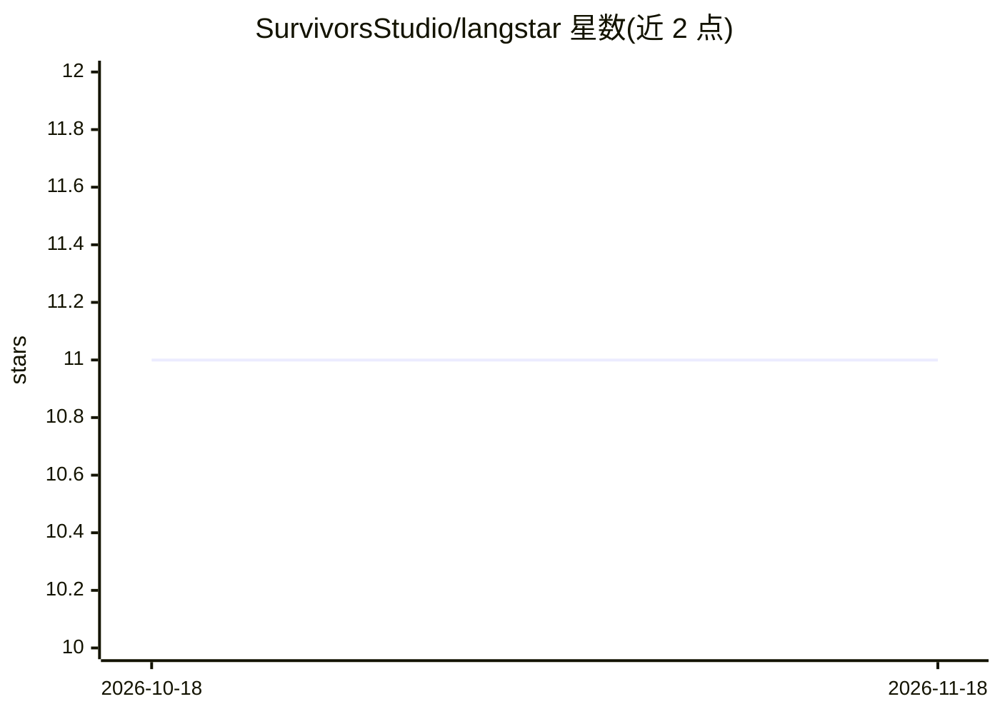

# SurvivorsStudio/langstar

⭐ 11 · TypeScript · MIT · 推送 2026-11-13 · [GitHub](https://github.com/SurvivorsStudio/langstar) · 组织维护

**面向开发/非开发者的拖拽式 LLM Agent 可视化构建平台**

LangStar 是一个可视化 no-code/low-code 平台，用户通过拖拽节点（Prompt、Agent、Condition、Merge、自定义 Python 等）编排 LLM Agent 工作流，自动生成 LangGraph Python 代码并可在本地执行、测试与实时调试。项目处于开发期，模型接入当前完整支持 AWS Bedrock，OpenAI/Google/Anthropic 仅有 UI、后端集成进行中；持久化依赖 MongoDB 8。技术栈为 React 18 + FastAPI，MIT 许可，支持 Docker Compose 运行。

## 筛选速览

| 维度 | 判定 | 备注 |
|---|---|---|
| AI 角色 | `ai-ecosystem` | LLM/agent 周边工具 |
| 许可风险 | `permissive` | MIT |
| 部署形态 | `self-host` | docker 或自建部署 |
| 模型依赖 | locked-api |  |
| 硬件要求 | — | 无带数字的原话,不猜 |
| 安装摩擦 | `low` | 无编译、无系统依赖或容器化 |
| 成熟度 | `idea` | |

## 能力要点

- 拖拽式工作流编辑，自动生成 LangGraph Python 代码
- 8 类节点（含自定义 Python 代码块）与单节点调试
- AWS Bedrock 模型完整支持及 API key/参数管理
- 工作流 JSON 导入导出与实时聊天界面

## 适用场景

- 不用写代码也能搭建 LLM Agent 流程
- 可视化调试 Agent 每个节点的中间输出
- 本地运行和测试生成的 Agent 工作流

## 场景标签

`Agent 框架` · 领域:Agent 开发

## 证据(README 行号)

> L12: **LangStar** is a visual no-code/low-code platform that enables both developers and non-developers to easily build 
> L46: - **Automatic LangGraph code generation**
> L332: - **LangChain** + **LangGraph** - AI agent framework

## 星数曲线

2026-10-18 11 → 2026-11-18 11（+0）

---
*卡片 v1 · prompt 1.4 · 生成 2026-11-18 · 置信度 high · 依据 README sha `12760be1e047` · [字段定义](../../DATASET.md)*
