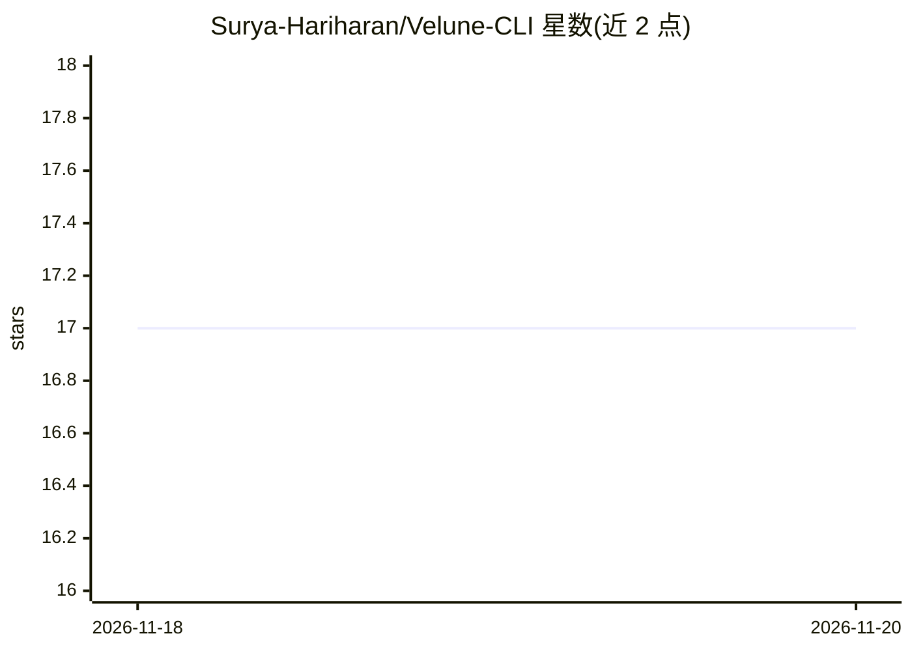

# Surya-Hariharan/Velune-CLI

⭐ 17 · Python · Apache-2.0 · 推送 2026-11-18 · [GitHub](https://github.com/Surya-Hariharan/Velune-CLI) · [官网](https://velune-cli.vercel.app/) · 个人维护

**本地优先的终端 AI 编程助手：多智能体协作改代码**

开源的命令行 AI 编程助手，面向在终端中开发、重构与自动化操作代码库的开发者。采用多智能体议会机制（Planner/Coder/Reviewer/Challenger/Synthesizer 等，最多九席），配合五级项目记忆与三级执行模式（Manual 默认，所有改动以 diff 形式需用户批准，可 /rewind 撤销）。支持 18 个模型提供方（4 本地、14 云端）、MCP 客户端与服务端、Docker 等可选集成。自我声明 beta 状态，命令执行为进程管理而非 OS 级沙箱（Docker 沙箱可选），无分析遥测。提供安装脚本与 pipx/uv 安装，测试覆盖 Windows/macOS/Linux。

## 筛选速览

| 维度 | 判定 | 备注 |
|---|---|---|
| AI 角色 | `ai-ecosystem` | LLM/agent 周边工具 |
| 许可风险 | `permissive` | Apache-2.0 |
| 部署形态 | `library` | 以包/库形式分发 |
| 模型依赖 | local-ok | 支持本地模型 |
| 硬件要求 | — | 无带数字的原话,不猜 |
| 安装摩擦 | `low` | 无编译、无系统依赖或容器化 |
| 成熟度 | `idea` | |

## 能力要点

- 多智能体议会机制，最多九席（含 Challenger 质询角色）
- 18 个模型提供方：4 本地（含 Ollama）+ 14 云端
- 五级项目记忆与三级执行模式，默认手动批准每个 diff，支持 /rewind 撤销
- MCP 客户端与服务端，支持插件、钩子与自定义斜杠命令（56 个内置命令）

## 适用场景

- 在终端里让多个 AI 角色协作完成代码重构或新功能
- 本地运行模型处理代码任务，代码与数据不出本机
- 通过 MCP 与外部工具、数据库（PostgreSQL/MySQL 等）集成自动化工作流

## 场景标签

`编码 Agent` `多智能体` · 领域:Agent 开发

## 证据(README 行号)

> L7:  An open-source, local-first AI engineer for your terminal.
> L60: Velune CLI at the centre, connecting to 18 model providers (4 local and 14 cloud), to opt-in application integratio

## 星数曲线

2026-11-18 17 → 2026-11-20 17（+0）

---
*卡片 v1 · prompt 1.4 · 生成 2026-11-18 · 置信度 high · 依据 README sha `d1738ef91e9a` · [字段定义](../../DATASET.md)*
