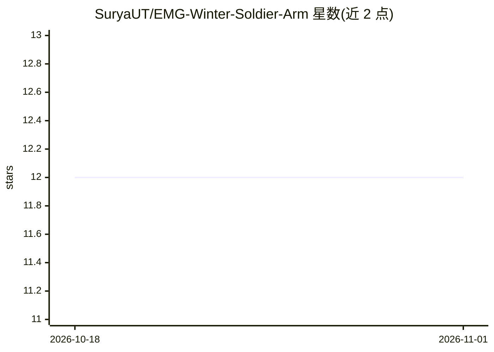

# SuryaUT/EMG-Winter-Soldier-Arm

⭐ 12 · C · MIT · 推送 2026-07-29 · [GitHub](https://github.com/SuryaUT/EMG-Winter-Soldier-Arm) · 个人维护

**EMG 肌电控制仿生手臂：ESP32-S3 上端到端手势分类与驱动**

3D 打印机械手项目：4 个前臂 EMG 传感器以 1 kHz DMA 采样，提取 69 维特征，在 ESP32-S3 上以三个并行模型（LDA、3 专家 LDA 集成、TFLite Micro int8 MLP）投票分类 5 种手势，经 EMA 与滞回门控后驱动 PCA9685 控制 5 个手指舵机与二头肌舵机。固件基于 ESP-IDF/FreeRTOS，附 Python 训练流水线（数据采集 GUI、模型训练、C 头文件导出），支持无传感器回放模式与按用户 Z-score 标定。面向硬件制作者，提供物料清单与分阶段搭建指南，需自行采购电子元件并 3D 打印。

## 筛选速览

| 维度 | 判定 | 备注 |
|---|---|---|
| AI 角色 | `ai-native` | 本体是模型或模型工具 |
| 许可风险 | `permissive` | MIT |
| 部署形态 | `library` | 以包/库形式分发 |
| 模型依赖 | — | README 未给出锁定关系 |
| 硬件要求 | — | 无带数字的原话,不猜 |
| 安装摩擦 | `low` | 无编译、无系统依赖或容器化 |
| 成熟度 | — | 结构信号不足 |

## 能力要点

- 全部推理在 ESP32-S3 片上运行，推理期无需电脑
- LDA+3 专家集成+int8 MLP 三模型并行投票，EMA 平滑与滞回门控
- 69 维时域/频域/跨通道 EMG 特征与按用户 Z-score 标定（NVS 持久化）
- Python GUI 训练流水线一键导出 C 头文件权重；可无传感器回放运行

## 适用场景

- 复刻一只由前臂肌电信号驱动的仿生手
- 学习 EMG 信号处理与嵌入式 TinyML 推理的完整流程
- 在无硬件条件下体验手势分类管线（回放模式）

## 场景标签

 · 领域:机器人/嵌入式硬件

## 证据(README 行号)

> L3: > **Status:** Complete and working end to end, flex your forearm and the hand forms the gesture; flex your bicep and
> L164: - **On-device inference**: All classification runs on the ESP32-S3. No laptop in the loop.

## 星数曲线

2026-10-18 12 → 2026-11-01 12（+0）

---
*卡片 v1 · prompt 1.4 · 生成 2026-11-01 · 置信度 mid · 依据 README sha `2f6996ccc223` · [字段定义](../../DATASET.md)*
