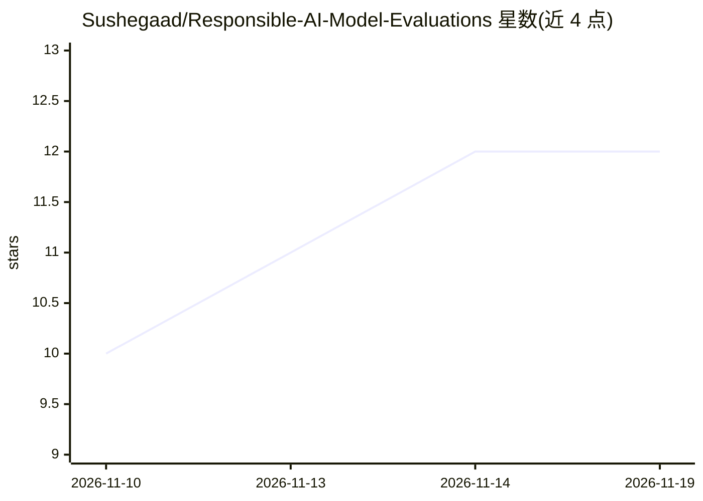

# Sushegaad/Responsible-AI-Model-Evaluations

⭐ 12 · Python · MIT · 推送 2026-05-31 · [GitHub](https://github.com/Sushegaad/Responsible-AI-Model-Evaluations) · [官网](https://sushegaad.github.io/Responsible-AI-Model-Evaluations/) · 个人维护

**面向 AI 安全研究者的 LLM 红队评测研究存档**

一项已完结的九周红队评测研究：对 Anthropic、OpenAI、Google 的 7 个前沿 LLM 在 22 个安全风险类别上执行 26,500 次对抗性与良性提示评测，经正则与神经双判官评估后生成安全排行榜，并将失败映射到 NIST AI RMF 四个功能域。产出交互式仪表板与研究论文；流水线、RedBench 数据集快照与全部结果归档于仓库，声明仍可完整复现运行，但研究本身已结束、无后续运行计划。

## 筛选速览

| 维度 | 判定 | 备注 |
|---|---|---|
| AI 角色 | `ai-knowledge` | 知识聚合/清单类 |
| 许可风险 | `permissive` | MIT |
| 部署形态 | `library` | 以包/库形式分发 |
| 模型依赖 | — | README 未给出锁定关系 |
| 硬件要求 | — | 无带数字的原话,不猜 |
| 安装摩擦 | `low` | 无编译、无系统依赖或容器化 |
| 成熟度 | — | 结构信号不足 |

## 能力要点

- 26,500 次评测覆盖 7 个模型与 22 个风险类别，含 468 条关键发现
- RegexJudge 确定性匹配 + NeuralJudge（Claude Haiku 4.5）结构化判定的双判官机制
- 失败自动映射到 NIST AI RMF（GOVERN/MAP/MEASURE/MANAGE）并生成审计日志
- RedBench 快照（29,362 行 Parquet）随仓库提交，运行无需访问数据集宿主

## 适用场景

- 复现九周红队评测流水线并部署结果仪表板
- 查阅各前沿模型在 ASR、误拒率、护栏漂移上的周度趋势
- 按 NIST AI RMF 对齐口径整理安全合规证据

## 场景标签

`模型评测` `科研工具` · 领域:评测与运维

## 证据(README 行号)

> L7: A completed nine-week red-teaming study of seven frontier large language models across 22 safety risk categories. 26
> L15: *A Nine-Week Red-Teaming Study of Foundation Models Across 22 Safety Risk Categories* — Hemant Naik, May 22, 2026. 
> L94: RedBench (Dang et al., 2026) aggregates 37 adversarial sub-benchmarks — including HarmBench, ToxiGen, XSTest, DAN, 

## 星数曲线

2026-11-10 10 → 2026-11-19 12（+2）

---
*卡片 v1 · prompt 1.4 · 生成 2026-11-18 · 置信度 high · 依据 README sha `eef0cc0204b8` · [字段定义](../../DATASET.md)*
