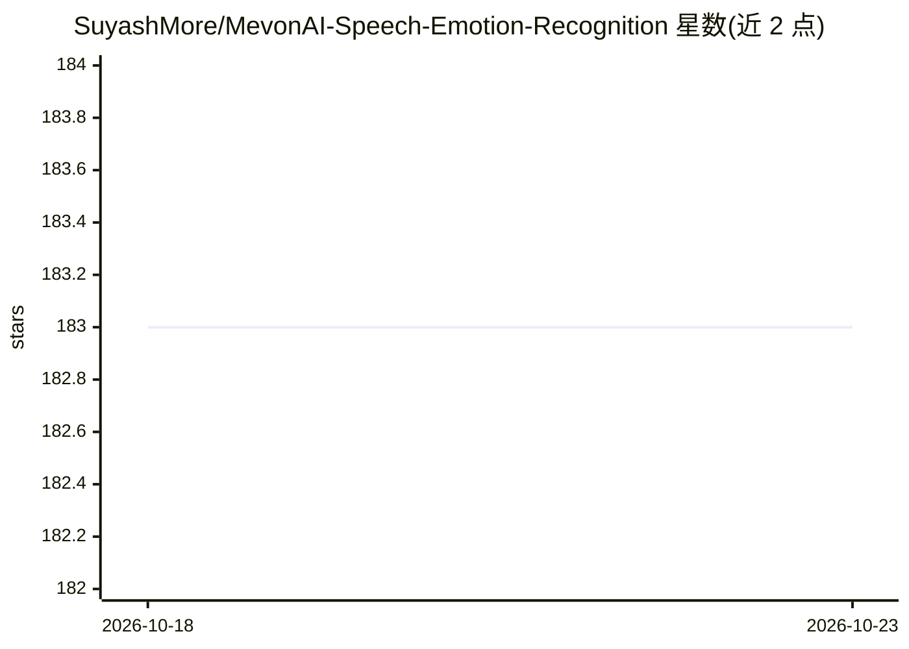

# SuyashMore/MevonAI-Speech-Emotion-Recognition

⭐ 183 · C · MIT · 推送 2026-08-09 · [GitHub](https://github.com/SuyashMore/MevonAI-Speech-Emotion-Recognition) · [官网](https://colab.research.google.com/github/SuyashMore/MevonAI-Speech-Emotion-Recognition/blob/master/src/notebooks/Emotion_Recognition_Demo.ipynb) · 个人维护

**多说话人音频情感识别工具：分离说话人并预测情感**

面向呼叫中心客户满意度反馈场景的语音情感识别项目：对 .wav 音频先做说话人分离（diarization，基于 UIS-RNN 与说话人嵌入），再提取 MFCC 特征，用 TensorFlow-Keras 构建的 CNN 模型对每个说话人的语音片段预测情感，结果输出到 CSV 文件，分离后的音频存于输出目录。仓库内置预训练模型（RAVDESS 数据集训练），提供 Docker 镜像与源码两种运行方式，并有 Colab 演示。限制：需 Python 3.6.9 环境，输入限 .wav 格式。

## 筛选速览

| 维度 | 判定 | 备注 |
|---|---|---|
| AI 角色 | `ai-native` | 本体是模型或模型工具 |
| 许可风险 | `permissive` | MIT |
| 部署形态 | `self-host` | docker 或自建部署 |
| 模型依赖 | — | README 未给出锁定关系 |
| 硬件要求 | — | 无带数字的原话,不猜 |
| 安装摩擦 | `low` | 无编译、无系统依赖或容器化 |
| 成熟度 | — | 结构信号不足 |

## 能力要点

- 说话人分离 + MFCC 特征提取 + CNN 情感分类的流水线
- 默认使用仓库内置预训练模型（RAVDESS 数据集训练）
- 提供 Docker 镜像与 Colab 在线演示两种运行途径
- 分离后音频存于 src/output/，预测情感输出为 CSV 文件

## 适用场景

- 呼叫中心分析客户通话中各说话人的情感状态
- 对多人对话录音按说话人分别输出情感预测结果
- 用 RAVDESS 数据集复现训练自己的情感识别模型

## 场景标签

`语音识别` `数据分析` · 领域:效率与自动化

## 证据(README 行号)

> L11:  Identify the emotion of multiple speakers in a Audio Segment
> L94: #### Speaker Diarization
> L106: * Use Convolutional Neural Network to recognize emotion on the MFCCs with the following Architecture

## 星数曲线

2026-10-18 183 → 2026-10-23 183（+0）

---
*卡片 v1 · prompt 1.4 · 生成 2026-10-22 · 置信度 high · 依据 README sha `f2920629e950` · [字段定义](../../DATASET.md)*
