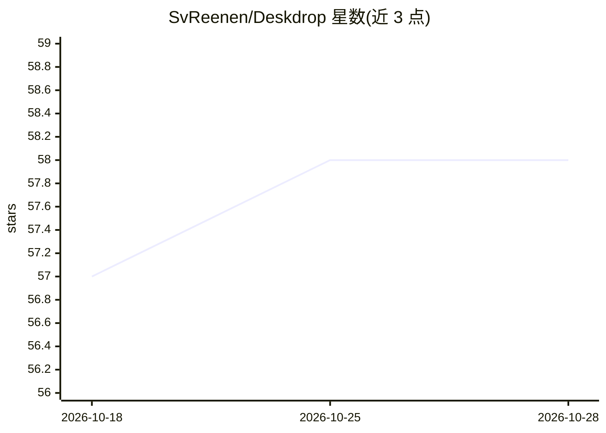

# SvReenen/Deskdrop

⭐ 58 · Kotlin · GPL-3.0 · 推送 2026-10-28 · [GitHub](https://github.com/SvReenen/Deskdrop) · [官网](https://svreenen.github.io/Deskdrop/) · 个人维护

**带本地/云端 AI 的 Android 隐私键盘（HeliBoard 分支）**

基于 HeliBoard 的 Android 输入法分支，在保留原键盘功能（主题、布局、剪贴板历史、滑行输入）之上叠加 AI 层：改写/翻译/摘要、内联 // 命令、剪贴板上下文、语音输入（Google 语音或自托管 Whisper）、多轮对话与工具调用（17 个内置工具、MCP 支持 Home Assistant）。后端可选 Ollama/LM Studio/vLLM/llama.cpp/KoboldCpp/任意 OpenAI 兼容服务器，或 Groq/Gemini/OpenRouter 等云 API，另有设备端 ONNX 推理。以 APK 经 GitHub Releases 分发，未上架 Play Store。面向自托管用户与注重隐私的 Android 用户。

## 筛选速览

| 维度 | 判定 | 备注 |
|---|---|---|
| AI 角色 | `ai-enhanced` | 去掉 AI 部分产品仍成立 |
| 许可风险 | `viral` | GPL-3.0 |
| 部署形态 | `None` |  |
| 模型依赖 | local-ok | 支持本地模型 |
| 硬件要求 | — | 无带数字的原话,不猜 |
| 安装摩擦 | `low` | 无编译、无系统依赖或容器化 |
| 成熟度 | — | 结构信号不足 |

## 能力要点

- 多后端：本地 Ollama/OpenAI 兼容服务器、云 API 与设备端 ONNX 推理
- 17 个内置 AI 工具与 MCP 支持（Home Assistant、自定义工具服务器）
- API key AES-256-GCM 加密、无遥测、密码字段屏蔽 AI 功能
- 本地服务器宕机时自动切换云端备用

## 适用场景

- 在任意输入框直接改写、翻译、摘要或调整语气
- 连接家中 Ollama/家庭助理服务器实现全本地 AI 输入
- 通过语音与剪贴板上下文快速处理文字

## 场景标签

`AI 写作` `语音识别` · 领域:内容生成

## 证据(README 行号)

> L8: Deskdrop is an Android keyboard with AI built in. Use Ollama, any OpenAI-compatible server, or a cloud API key. Buil
> L209: Deskdrop is built on HeliBoard, an open-source privacy-focused keyboard for Android. All original HeliBoard featur

## 星数曲线

2026-10-18 57 → 2026-10-28 58（+1）

---
*卡片 v1 · prompt 1.4 · 生成 2026-10-24 · 置信度 high · 依据 README sha `771766f2e697` · [字段定义](../../DATASET.md)*
