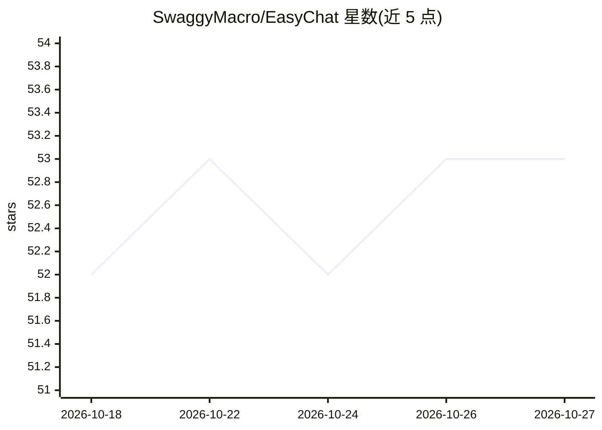

# SwaggyMacro/EasyChat

⭐ 53 · C# · MIT · 推送 2026-09-19 · [GitHub](https://github.com/SwaggyMacro/EasyChat) · [官网](https://easychat.ncii.cn) · 个人维护 · 中文 README

**桌面即时翻译与语言辅助工具：截图/划词/语音翻译**

面向 Windows 桌面用户的即时翻译与语言辅助软件，以安装包或便携版形式分发。功能包括截图翻译（OCR 支持 80+ 种语言）、截图取词、划词工具栏翻译、输入框写回翻译、快捷翻译、文本润色/总结/语法纠错、实时语音识别生成双语字幕（适用于视频、直播、会议、课程）以及同声传译。翻译能力需在设置中接入翻译服务；截图 OCR 与实时语音识别需下载本地模型。

## 筛选速览

| 维度 | 判定 | 备注 |
|---|---|---|
| AI 角色 | `ai-native` | 本体是模型或模型工具 |
| 许可风险 | `permissive` | MIT |
| 部署形态 | `desktop` | 安装包/桌面程序 |
| 模型依赖 | — | README 未给出锁定关系 |
| 硬件要求 | — | 无带数字的原话,不猜 |
| 安装摩擦 | `low` | 无编译、无系统依赖或容器化 |
| 成熟度 | — | 结构信号不足 |

## 能力要点

- 截图翻译，OCR 支持 80+ 种语言
- 实时语音识别系统声音并显示双语字幕
- 划词、输入框写回等多种翻译交互方式
- 提供润色、总结、语法纠错与同声传译

## 适用场景

- 看视频、直播或开会时显示双语实时字幕
- 框选屏幕区域即时翻译图片或软件界面文字
- 选中文本快速翻译、润色或纠错

## 场景标签

`语音识别` `OCR` `AI 写作` · 领域:内容生成

## 证据(README 行号)

> L11: EasyChat 是一款面向桌面的即时翻译与语言辅助工具，当前版本支持 Windows。它可以处理图片、文本和声音，也提供润色、总结、语法纠错及实时翻译字幕。
> L23: - **截图翻译**：框选网页、视频、图片或软件界面，识别并显示译文，OCR 支持 80+ 种语言。
> L29: - **实时语音识别**：识别系统声音并在悬浮窗中显示双语字幕，支持视频、直播、会议和课程。

## 星数曲线

2026-10-18 52 → 2026-10-27 53（+1）

---
*卡片 v1 · prompt 1.4 · 生成 2026-10-24 · 置信度 high · 依据 README sha `33bce46f2458` · [字段定义](../../DATASET.md)*
