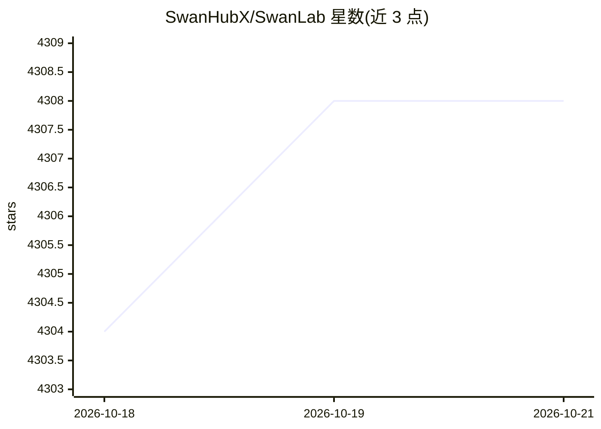

# SwanHubX/SwanLab

⭐ 4,308 · Python · Apache-2.0 · 推送 2026-10-15 · [GitHub](https://github.com/SwanHubX/SwanLab) · [官网](https://swanlab.cn) · 组织维护 · 中文 README

**面向模型训练团队的 AI 训练跟踪与可视化平台**

AI 训练分析与指标观测平台：通过极简代码嵌入机器学习 pipeline，记录训练指标、超参数、日志、硬件环境与 Git/Python 环境等元数据，提供折线图、媒体图、3D 点云、ECharts 自定义图表等可视化与实验对比、分组、Baseline 对比功能。支持云端与自托管（Docker/Kubernetes 私有化部署），与 PyTorch、Transformers、LLaMA Factory、veRL 等 30+ 框架集成，硬件监控覆盖 Nvidia/昇腾/寒武纪/AMD ROCm 等多种 GPU/NPU。以 pip 包与源码两种方式安装。

## 筛选速览

| 维度 | 判定 | 备注 |
|---|---|---|
| AI 角色 | `ai-ecosystem` | LLM/agent 周边工具 |
| 许可风险 | `permissive` | Apache-2.0 |
| 部署形态 | `library` | 以包/库形式分发 |
| 模型依赖 | — | README 未给出锁定关系 |
| 硬件要求 | — | 无带数字的原话,不猜 |
| 安装摩擦 | `low` | 无编译、无系统依赖或容器化 |
| 成熟度 | — | 结构信号不足 |

## 能力要点

- pip 一行安装，代码嵌入即可记录指标、超参数与日志
- 30+ 框架集成（PyTorch/Transformers/LLaMA Factory/veRL/Ultralytics 等）
- 硬件监控覆盖 Nvidia、昇腾、寒武纪、昆仑芯、AMD ROCm 等
- 云端与自托管（Docker/Kubernetes 私有化部署）两种使用方式

## 适用场景

- 训练过程中实时查看指标曲线并对比多个实验
- 团队在网页端协同查看训练记录并分享实验链接
- 离线/私有化环境下自托管看板管理实验

## 场景标签

`MLOps` · 领域:训练与推理

## 证据(README 行号)

> L149: SwanLab 是一款**AI训练分析与指标观测平台**，面向模型训练团队，提供训练可视化、自动日志记录、超参数记录、实验对比、多人协同等功能，帮助团队快速发现训练问题，加速模型迭代。
> L157: **1. 📊 实验指标与超参数跟踪**: 极简的代码嵌入您的机器学习 pipeline，跟踪记录训练关键指标

## 星数曲线

2026-10-18 4,304 → 2026-10-21 4,308（+4）

---
*卡片 v1 · prompt 1.4 · 生成 2026-10-20 · 置信度 high · 依据 README sha `3f52b01d9433` · [字段定义](../../DATASET.md)*
