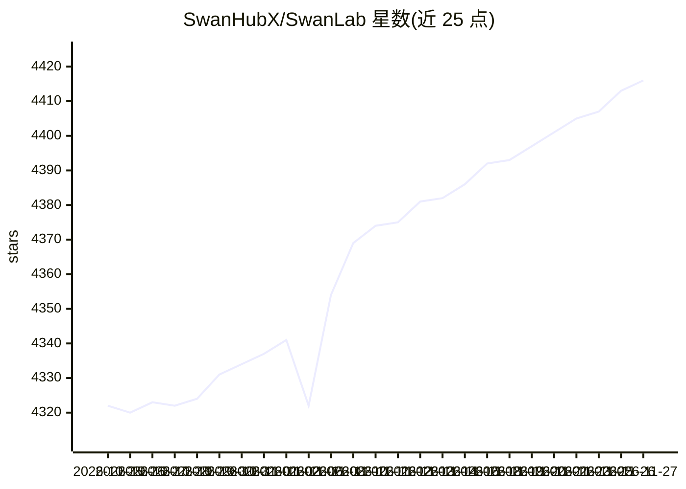

# SwanHubX/SwanLab

⭐ 4,416 · Python · Apache-2.0 · 推送 2026-11-26 · [GitHub](https://github.com/SwanHubX/SwanLab) · [官网](https://swanlab.cn) · 组织维护 · 中文 README

**面向模型训练团队的AI训练跟踪与可视化平台**

SwanLab 是一个 AI 训练分析与指标观测平台，提供实验指标与超参数跟踪、训练可视化、实验对比、多人协同与分享 URL 等功能，支持云端与自托管两种使用方式。与 PyTorch、Transformers、LLaMA Factory、veRL 等 30+ 框架集成，两行代码嵌入训练管线即可自动记录指标、硬件环境、Git 仓库与 Python 环境；记录类型覆盖标量、图像、音频、文本、视频、3D 点云，并针对 LLM 训练提供文本内容可视化组件。通过插件（飞书/Slack 通知、CSV 记录器）与 OpenAPI/RESTAPI 扩展。

## 筛选速览

| 维度 | 判定 | 备注 |
|---|---|---|
| AI 角色 | `ai-ecosystem` | LLM/agent 周边工具 |
| 许可风险 | `permissive` | Apache-2.0 |
| 部署形态 | `library` | 以包/库形式分发 |
| 模型依赖 | — | README 未给出锁定关系 |
| 硬件要求 | — | 无带数字的原话,不猜 |
| 安装摩擦 | `low` | 无编译、无系统依赖或容器化 |
| 成熟度 | — | 结构信号不足 |

## 能力要点

- 支持云端与自托管，自托管社区版可离线查看仪表盘
- 硬件监控覆盖英伟达/AMD GPU、昇腾NPU、寒武纪MLU、昆仑芯XPU等10类硬件指标
- 与 30+ 训练框架集成，含 LLM 训练与强化学习框架
- LLM 生成内容可视化组件，支持 Markdown 渲染

## 适用场景

- 跟踪深度学习训练指标并在网页端对比多个实验
- 团队多人协同记录训练、同步实验到同一项目下
- 离线环境自托管部署，私有化管理训练实验
- LLM 微调/RL 训练中记录并可视化生成文本内容

## 场景标签

`MLOps` · 领域:训练与推理

## 证据(README 行号)

> L31: SwanLab 是一款**AI训练分析与指标观测平台**，面向模型训练团队，提供训练可视化、自动日志记录、超参数记录、实验对比、多人协同等功能，帮助团队快速发现训练问题，加速模型迭代。
> L63: **2. ⚡️ 全面的框架集成**: PyTorch、🤗HuggingFace Transformers、PyTorch Lightning、🦙LLaMA Factory、MMDetection、Ultralytics、Paddl
> L75: **8. 💻 支持自托管**: 支持离线环境使用，自托管的社区版同样可以查看仪表盘与管理实验，使用攻略

## 星数曲线

2026-10-25 4,322 → 2026-11-27 4,416（+94）

---
*卡片 v1 · prompt 1.4 · 生成 2026-11-22 · 置信度 high · 依据 README sha `cd1893202137` · [字段定义](../../DATASET.md)*
