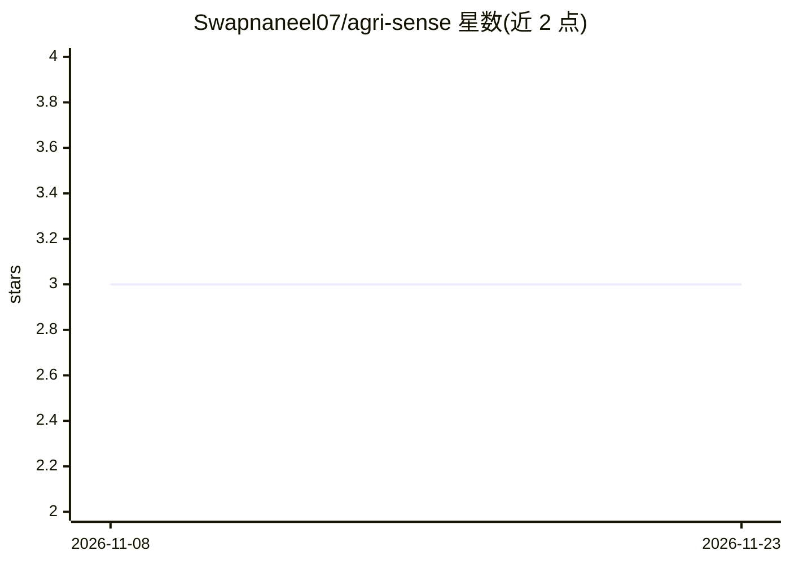

# Swapnaneel07/agri-sense

⭐ 3 · Python · 推送 2026-11-05 · [GitHub](https://github.com/Swapnaneel07/agri-sense) · 组织维护

**面向精准农业深度学习课程的多页 Streamlit 推理仪表盘**

为一个 5 模块深度学习学术课程构建的端到端套件：将课程模块集成到统一的多页 Streamlit 仪表盘中，提供实时推理、消融实验、损失曲线、混淆矩阵与基准对比表。模块覆盖土壤化学/气候参数的 MLP 产量预测、MobileNetV2 叶病识别（编译为 ExecuTorch .pte 供边缘离线推理）、LSTM/GRU/BiLSTM 土壤湿度时序预测，以及 cVAE 合成稀有叶病样本。完全本地离线运行；模型检查点缺失时以 Mock Mode 保持表单与可视化可测试。

## 筛选速览

| 维度 | 判定 | 备注 |
|---|---|---|
| AI 角色 | `ai-native` | 本体是模型或模型工具 |
| 许可风险 | `none` | — |
| 部署形态 | `desktop` | 安装包/桌面程序 |
| 模型依赖 | — | README 未给出锁定关系 |
| 硬件要求 | — | 无带数字的原话,不猜 |
| 安装摩擦 | `low` | 无编译、无系统依赖或容器化 |
| 成熟度 | — | 结构信号不足 |

## 能力要点

- 5 个课程模块对应 5 个仪表盘页面，含消融与基准对比
- MobileNetV2 叶病模型编译为 ExecuTorch .pte 格式做边缘离线推理
- LSTM/GRU/BiLSTM/Persistence 土壤湿度时序预测对比
- 条件 VAE 生成稀有类别叶病合成样本

## 适用场景

- 课程教学中演示作物产量预测与叶病识别
- 土壤湿度时间序列预测模型对比实验
- 用合成样本缓解叶病数据集类别不平衡

## 场景标签

`教程课程` · 领域:学习与行业

## 证据(README 行号)

> L3: AgriSense AI is an end-to-end precision agriculture deep learning suite designed for a 5-module Deep Learning academ
> L52: |**Module 4**|RNN, LSTM, GRU, BiLSTM|Sequential soil moisture forecasting on Arnesano IoT sliding windows (24 times

## 星数曲线

2026-11-08 3 → 2026-11-23 3（+0）

---
*卡片 v1 · prompt 1.4 · 生成 2026-11-22 · 置信度 high · 依据 README sha `18ee6a035ec1` · [字段定义](../../DATASET.md)*
