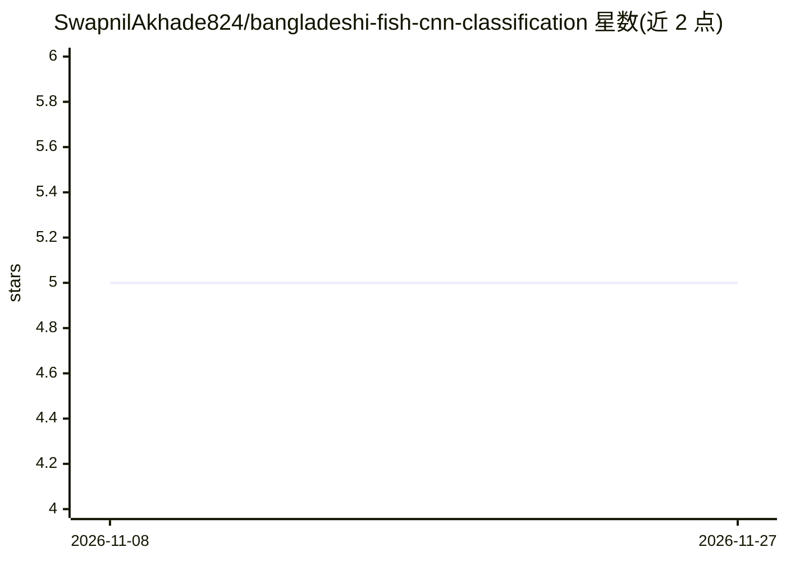

# SwapnilAkhade824/bangladeshi-fish-cnn-classification

⭐ 5 · Jupyter Notebook · 推送 2026-10-31 · [GitHub](https://github.com/SwapnilAkhade824/bangladeshi-fish-cnn-classification) · [官网](https://swapnilakhade824.github.io/bangladeshi-fish-cnn-classification/) · 组织维护

**面向科研/学生：15 种孟加拉淡水鱼的 CNN 图像分类课程项目**

基于 BFF-15 数据集（15 个物种）的图像分类实验工程，用四个 Colab notebook 组织：数据扫描去重与冻结的 70/15/15 分层切分、从零训练 CNN、微调 MobileNetV2、共享评估流程对比两模型（accuracy/precision/recall/F1/混淆矩阵），并做 McNemar 显著性检验；结果导出 JSON 后由 GitHub Pages 静态页面展示。数据集（约 40 MB，CC BY 4.0）随仓库提交，训练以可恢复 checkpoint 支持断线续跑。

## 筛选速览

| 维度 | 判定 | 备注 |
|---|---|---|
| AI 角色 | `ai-native` | 本体是模型或模型工具 |
| 许可风险 | `none` | — |
| 部署形态 | `library` | 以包/库形式分发 |
| 模型依赖 | — | README 未给出锁定关系 |
| 硬件要求 | — | 无带数字的原话,不猜 |
| 安装摩擦 | `low` | 无编译、无系统依赖或容器化 |
| 成熟度 | — | 结构信号不足 |

## 能力要点

- 从零 CNN 与微调 MobileNetV2 两模型共享同一冻结切分与类映射
- 字节级去重与 70/15/15 分层冻结切分
- McNemar 显著性检验与共享评估管线
- GitHub Pages 静态结果站由 notebook 03 导出刷新

## 适用场景

- 复现 15 种孟加拉淡水鱼的分类实验
- 课程小组按 notebook 分工协作训练与评估
- 在 Colab T4 GPU 上断线续跑训练

## 场景标签

`科研工具` `教程课程` `目标检测` · 领域:学习与行业

## 证据(README 行号)

> L1: # Bangladeshi Freshwater Fish Image Classification Using CNN and Transfer Learning
> L31: |`notebooks/01_custom_cnn.ipynb`|Load BFF-15, preprocess, augment, train CNN from scratch, save checkpoints + logs 
> L33: |`notebooks/03_comparison.ipynb`|Read both folders, compare models via accuracy, precision, recall, F1, confusion m

## 星数曲线

2026-11-08 5 → 2026-11-27 5（+0）

---
*卡片 v1 · prompt 1.4 · 生成 2026-11-21 · 置信度 high · 依据 README sha `ec03b27d3be1` · [字段定义](../../DATASET.md)*
