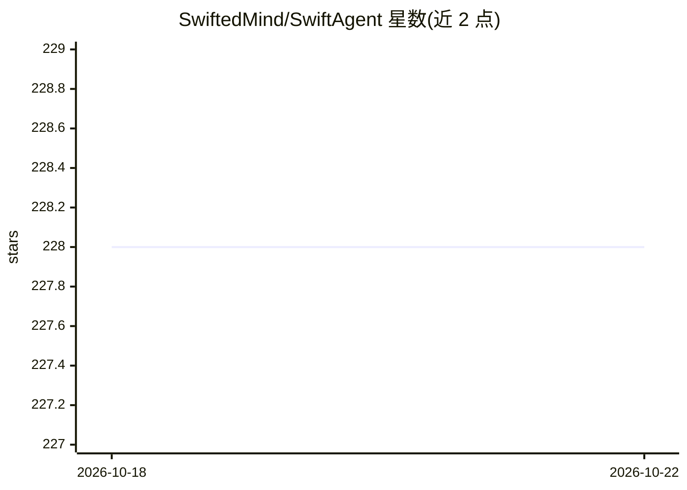

# SwiftedMind/SwiftAgent

⭐ 228 · Swift · MIT · 推送 2026-01-23 · [GitHub](https://github.com/SwiftedMind/SwiftAgent) · 个人维护

**Swift 原生 SDK：帮开发者构建自主 AI Agent**

面向 Swift 开发者的 AI Agent 构建框架，API 设计借鉴 Apple FoundationModels（@Generable、@SessionSchema、@PromptBuilder 等宏）。通过 Adapter 抽象接入 OpenAI 与 Anthropic，支持工具调用、可恢复的工具拒绝、结构化输出、流式响应（含部分生成投影）、会话 transcript 与 token 用量追踪；内置无 API 调用的模拟会话用于测试，并给出代理服务器与按回次鉴权方案。以 Swift Package Manager 集成，基于 Swift 6 与 async/await。

## 筛选速览

| 维度 | 判定 | 备注 |
|---|---|---|
| AI 角色 | `ai-ecosystem` | LLM/agent 周边工具 |
| 许可风险 | `permissive` | MIT |
| 部署形态 | `None` |  |
| 模型依赖 | — | README 未给出锁定关系 |
| 硬件要求 | — | 无带数字的原话,不猜 |
| 安装摩擦 | `medium` | 含编译或系统依赖之一 |
| 成熟度 | — | 结构信号不足 |

## 能力要点

- Adapter 抽象支持 OpenAI 与 Anthropic
- 基于 @Generable 的类型安全工具定义与可恢复工具拒绝
- 结构化输出与流式部分生成投影
- 内置模拟会话，无 API 调用即可开发测试

## 适用场景

- 在 Swift 应用中集成可调用工具的自主 Agent
- 构建带流式 UI 更新的结构化 AI 响应
- 通过代理服务器与短期 token 安全发布 AI 功能

## 场景标签

`Agent 框架` · 领域:Agent 开发

## 证据(README 行号)

> L3: **Native Swift SDK for building autonomous AI agents with Apple's FoundationModels design philosophy**
> L20: - **Zero-Setup Agent Loops** — Handle autonomous agent execution with just a few lines of code
> L22: - **Adapter Agnostic** — Abstract interface supports multiple AI adapters (OpenAI + Anthropic included, more coming

## 星数曲线

2026-10-18 228 → 2026-10-22 228（+0）

---
*卡片 v1 · prompt 1.4 · 生成 2026-10-22 · 置信度 high · 依据 README sha `46fcb266dd04` · [字段定义](../../DATASET.md)*
