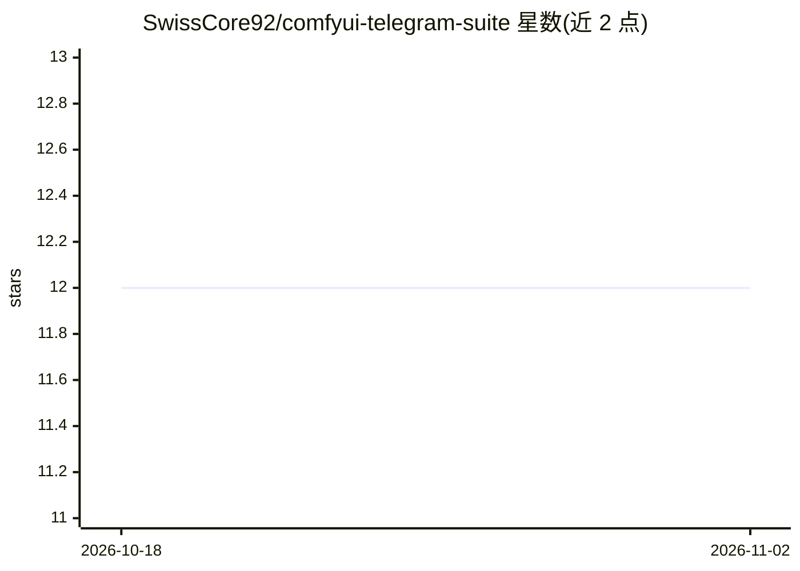

# SwissCore92/comfyui-telegram-suite

⭐ 12 · Python · MIT · 推送 2026-09-14 · [GitHub](https://github.com/SwissCore92/comfyui-telegram-suite) · 个人维护

**ComfyUI 节点套件：把生成结果通过 Telegram Bot 发送**

面向 ComfyUI 用户的自定义节点集合，提供 Telegram Bot 加载与消息/图片（最多10张、可媒体组）/视频/音频/聊天动作等发送节点，并含消息编辑、类型转换器与实验性功能。通过 trigger 直通输入控制工作流执行顺序（如先发 recording_voice 动作再生成音频）。配置经 config.json 填入 bot token 与 chat ID，支持自定义 telegram bot api url。运行需 ffmpeg，视频发送依赖 VHS_FILENAMES 类型（Video Helper Suite 输出）。

## 筛选速览

| 维度 | 判定 | 备注 |
|---|---|---|
| AI 角色 | `ai-ecosystem` | LLM/agent 周边工具 |
| 许可风险 | `permissive` | MIT |
| 部署形态 | `library` | 以包/库形式分发 |
| 模型依赖 | — | README 未给出锁定关系 |
| 硬件要求 | — | 无带数字的原话,不猜 |
| 安装摩擦 | `medium` | 含编译或系统依赖之一 |
| 成熟度 | — | 结构信号不足 |

## 能力要点

- 发送文本/图片（最多10张、支持媒体组）/视频/音频/聊天动作的节点集
- trigger 直通机制控制 ComfyUI 工作流执行顺序
- config.json 配置多 bot 与多 chat，支持自定义 telegram bot api url
- 兼容 ComfyUI Manager 安装

## 适用场景

- 把 ComfyUI 生成的图片/视频/音频自动推送到 Telegram
- 在 TTS 等工作流中先发送 typing/recording 状态再发送结果
- 多 bot 多 chat 的生成结果分发

## 场景标签

`工作流自动化` · 领域:效率与自动化

## 证据(README 行号)

> L5: **Implement Telegram into your ComfyUI workflows.**
> L11: The main nodes:

## 星数曲线

2026-10-18 12 → 2026-11-02 12（+0）

---
*卡片 v1 · prompt 1.4 · 生成 2026-11-01 · 置信度 mid · 依据 README sha `c2cc8ca16c09` · [字段定义](../../DATASET.md)*
