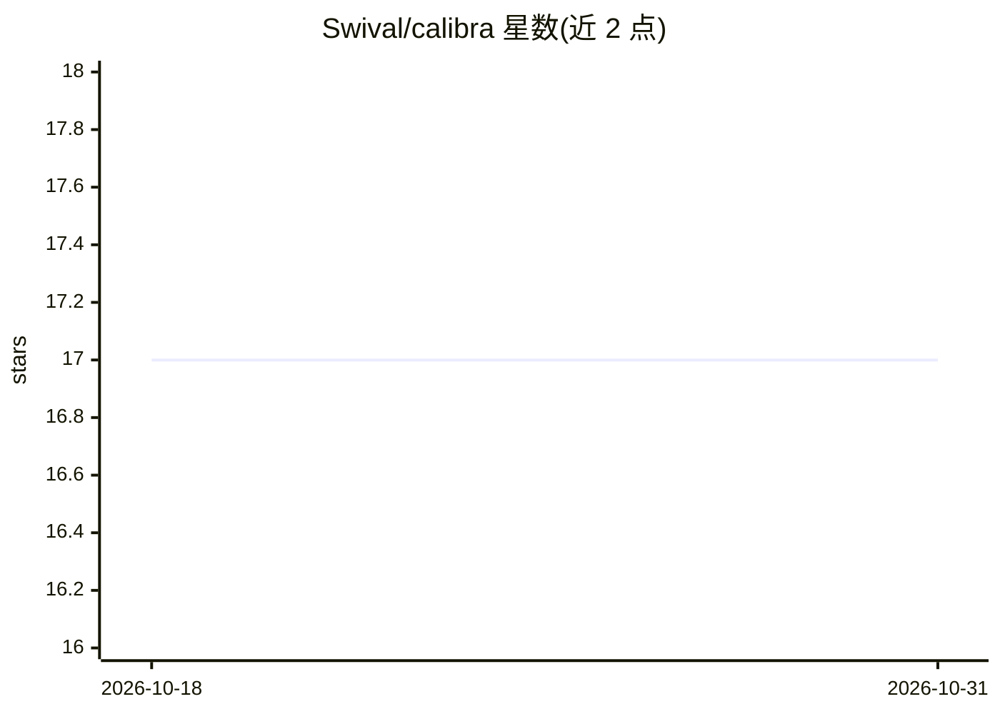

# Swival/calibra

⭐ 17 · Python · MIT · 推送 2026-10-27 · [GitHub](https://github.com/Swival/calibra) · [官网](https://calibra.swival.dev) · 组织维护

**面向编码 agent 的评测基准工具：矩阵化测模型与配置**

Calibra 是一个开源的编码 agent 基准测试 harness：用户定义模型、指令、技能、MCP 服务器、环境五维变体矩阵，工具自动运行全部组合，产出通过率、token 成本、耗时、失败分类与统计排名，并在可导出为静态 HTML 的交互式 Web 仪表盘中展示。支持 OpenAI、HuggingFace 及 LM Studio、Ollama 等 OpenAI 兼容端点作为 provider，全程本地运行、无遥测。通过 uv 安装并以 CLI 驱动，内置预算跟踪、确定性种子与失败重试。由 Swival 团队构建。

## 筛选速览

| 维度 | 判定 | 备注 |
|---|---|---|
| AI 角色 | `ai-ecosystem` | LLM/agent 周边工具 |
| 许可风险 | `permissive` | MIT |
| 部署形态 | `None` |  |
| 模型依赖 | local-ok | 支持本地模型 |
| 硬件要求 | — | 无带数字的原话,不猜 |
| 安装摩擦 | `low` | 无编译、无系统依赖或容器化 |
| 成熟度 | — | 结构信号不足 |

## 能力要点

- 模型/指令/技能/MCP/环境五维矩阵化实验
- 统计输出含置信区间、Pareto 前沿与效应量
- 本地运行，支持任意 OpenAI 兼容端点
- 交互式仪表盘可导出静态 HTML 分享

## 适用场景

- 切换模型或修改系统提示词前做对照实验
- 比较不同 MCP 服务器与技能组合对 agent 通过率的影响
- 团队内共享评测结果与排名

## 场景标签

`模型评测` · 领域:评测与运维

## 证据(README 行号)

> L8: Calibra is a benchmarking harness that tells you *exactly* how your coding agent performs across models, instruction
> L10: It works with any provider: OpenAI, HuggingFace, or your own self-hosted models via LM Studio, Ollama, or any OpenA

## 星数曲线

2026-10-18 17 → 2026-10-31 17（+0）

---
*卡片 v1 · prompt 1.4 · 生成 2026-10-29 · 置信度 high · 依据 README sha `086b1052ede2` · [字段定义](../../DATASET.md)*
