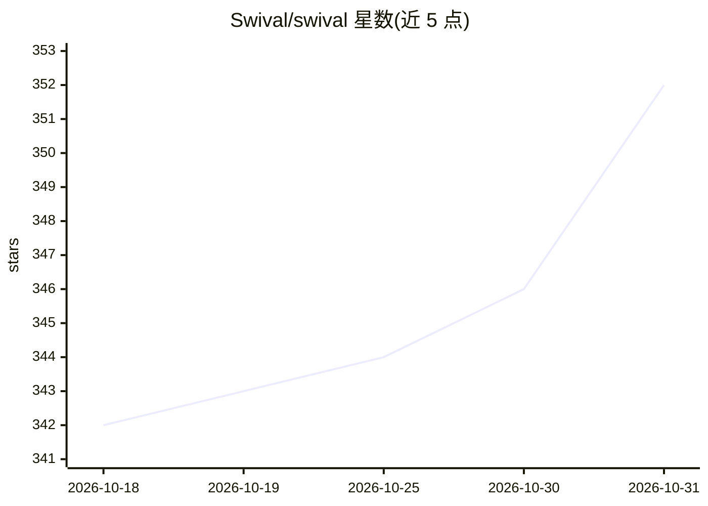

# Swival/swival

⭐ 352 · Python · MIT · 推送 2026-10-30 · [GitHub](https://github.com/Swival/swival) · [官网](https://swival.dev) · 个人维护

**面向任意模型的命令行编程 agent，本地与在线模型通用**

用 Python 编写的开源 CLI 编程 agent：可连接本地模型与在线服务，切换模型无需更换 agent；提供 API 密钥加密、隐私过滤（移除客户名、内部 URL 等）、会话笔记与中断续跑、目标设定；内置带审查步骤的自检（可由另一模型执行审查）与安全审计检查现有代码 bug。可连接其他工具与 agent，也可作为 Python 程序的一部分运行。安装途径为 uv 或 Homebrew（macOS），首次运行提供配置向导。

## 筛选速览

| 维度 | 判定 | 备注 |
|---|---|---|
| AI 角色 | `ai-native` | 本体是模型或模型工具 |
| 许可风险 | `permissive` | MIT |
| 部署形态 | `None` |  |
| 模型依赖 | — | README 未给出锁定关系 |
| 硬件要求 | — | 无带数字的原话,不猜 |
| 安装摩擦 | `low` | 无编译、无系统依赖或容器化 |
| 成熟度 | — | 结构信号不足 |

## 能力要点

- 同一工具内混用本地模型与在线服务，切换模型不换 agent
- 密钥加密选项与隐私过滤器（移除客户名、内部 URL）
- 会话笔记、中断恢复与目标导向的长任务执行
- 内置审查步骤（可换模型审查）与代码安全审计

## 适用场景

- 在终端里让本地或在线模型完成编码与修 bug 任务
- 处理需要多轮推进、可中断续跑的长编程任务
- 在含敏感信息的代码库中使用模型时过滤隐私细节

## 场景标签

`编码 Agent` · 领域:编码与开发

## 证据(README 行号)

> L5: A coding agent for any model.
> L7: Swival makes it easy to work with local models and online services in the same tool.
> L21: Swival is free, open source, and written in Python, so the code is available to read and change.

## 星数曲线

2026-10-18 342 → 2026-10-31 352（+10）

---
*卡片 v1 · prompt 1.4 · 生成 2026-10-21 · 置信度 mid · 依据 README sha `2f76cdf9b393` · [字段定义](../../DATASET.md)*
