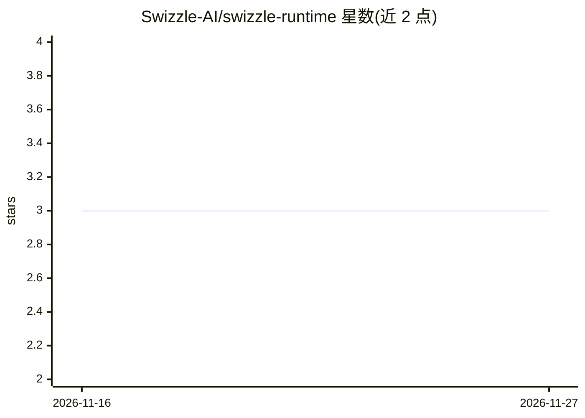

# Swizzle-AI/swizzle-runtime

⭐ 3 · Rust · Apache-2.0 · 推送 2026-11-23 · [GitHub](https://github.com/Swizzle-AI/swizzle-runtime) · [官网](https://swizzle-ten.vercel.app) · 组织维护

**Rust 编写的本地 LLM 推理运行时，读取 GGUF/.ktc 模型**

Swizzle Runtime 是用 Rust 编写的本地推理运行时，读取 GGUF 与 .ktc 格式模型，提供 CPU（AVX2/F16C）、CUDA 与 Vulkan 后端，声明各加速路径输出位级一致。内置自投机解码（RAD-1）、两级前缀缓存（Warm Start）、两阶段词表筛选（Shortlist）与 Convoy 连续批处理，并提供 verify-receipt 推理凭证校验。服务端兼容 OpenAI、llama.cpp llama-server 与 Ollama 三套 API，另带 pull/chat/serve/bench 子命令与 Prometheus 指标、Kubernetes 探针。提供安装脚本、Docker 镜像与 cargo 源码构建；CUDA 完整支持需 nvcc 12.8+。

## 筛选速览

| 维度 | 判定 | 备注 |
|---|---|---|
| AI 角色 | `ai-ecosystem` | LLM/agent 周边工具 |
| 许可风险 | `permissive` | Apache-2.0 |
| 部署形态 | `self-host` | docker 或自建部署 |
| 模型依赖 | local-ok | 支持本地模型 |
| 硬件要求 | `cpu-ok` | |
| 安装摩擦 | `low` | 无编译、无系统依赖或容器化 |
| 成熟度 | — | 结构信号不足 |

## 能力要点

- 支持 OpenAI、llama.cpp、Ollama 三套兼容 API 与 JSON Schema 结构化输出
- RAD-1 自投机解码与 Shortlist 词表筛选，声明位级一致的确定性输出
- 单一静态二进制覆盖 CPU/NVIDIA/AMD/Intel GPU（CUDA sm_75–sm_120 及 Vulkan）
- 内置 bench 基准与 HTTP 遥测头、Prometheus 指标、K8s 探针

## 适用场景

- 在本地 CPU/GPU 上运行 GGUF 模型推理
- 以 OpenAI 兼容接口为现有应用接入本地模型
- 需要可复现推理凭证与审计绑定的服务部署
- 在自有硬件上运行基准并对比延迟指标

## 场景标签

`推理引擎` · 领域:训练与推理

## 证据(README 行号)

> L22: **Swizzle Runtime** (`swizzle-rt`) is Swizzle AI's local high-throughput inference runtime, engineered in Rust and 
> L101: - **OpenAI API**: `/v1/chat/completions`, `/v1/completions`, `/v1/models`, `/v1/embeddings`, `/v1/rerank`, `/healt
> L107: - **Ollama API**: `/api/chat`, `/api/generate`, `/api/tags`, `/api/ps`, `/api/show`, `/api/version`

## 星数曲线

2026-11-16 3 → 2026-11-27 3（+0）

---
*卡片 v1 · prompt 1.4 · 生成 2026-11-22 · 置信度 high · 依据 README sha `9cd3db404b07` · [字段定义](../../DATASET.md)*
