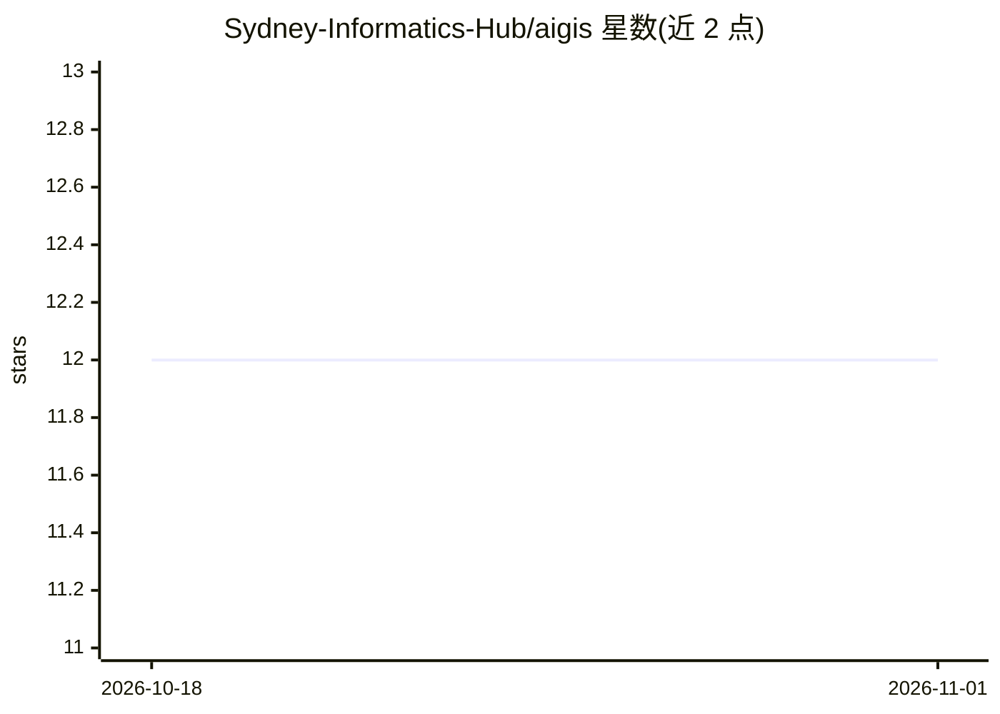

# Sydney-Informatics-Hub/aigis

⭐ 12 · Python · MIT · 推送 2026-03-10 · [GitHub](https://github.com/Sydney-Informatics-Hub/aigis) · 组织维护

**航拍/卫星影像 AI 标注、转换与分割工具包**

面向 GIS 遥感影像的 AI 工具包，含三个模块：aigis.annotate 从零生成影像标注，aigis.convert 在 COCO、GeoJSON 等格式与 AI 模型所需格式间互转，aigis.segment 提供基于视觉 Transformer 与 MaskRCNN 的训练、测试与部署脚本。模型可在大陆尺度批量运行或部署到边缘设备做实时推理。仅支持 Linux/macOS，微调推荐 CUDA GPU（RTX 4090/A100），由悉尼大学 Sydney Informatics Hub 团队开发，已用于大悉尼地区建筑与树木轮廓分割（近百万建筑、200 万树木斑块）。

## 筛选速览

| 维度 | 判定 | 备注 |
|---|---|---|
| AI 角色 | `ai-native` | 本体是模型或模型工具 |
| 许可风险 | `permissive` | MIT |
| 部署形态 | `library` | 以包/库形式分发 |
| 模型依赖 | — | README 未给出锁定关系 |
| 硬件要求 | — | 无带数字的原话,不猜 |
| 安装摩擦 | `medium` | 含编译或系统依赖之一 |
| 成熟度 | — | 结构信号不足 |

## 能力要点

- 标注、格式转换、分割三模块覆盖训练数据到部署全流程
- 基于通用视觉 Transformer 与 MaskRCNN 模型，不依赖特定时序/分辨率/波段输入
- 模型可大陆尺度批量推理或部署到算力受限边缘设备
- 提供大悉尼地区建筑与树木分割示例数据集（Huggingface）

## 适用场景

- 为航拍/卫星影像从零构建标注并训练分割模型
- 把 GIS 矢量/影像数据转为 COCO 等 AI 训练格式，或将预测结果转回 GIS 分析格式
- 大区域范围批量提取建筑或树木轮廓

## 场景标签

`目标检测` · 领域:感知与多模态

## 证据(README 行号)

> L16: `aigis` is a comprehensive toolkit for aerial and satellite imagery acquisition, processing, annotation, and analys
> L20: 3. **segment:** Scripts and notebooks for segmenting aerial imagery using deep learning models.
> L24: Rather than develop models that depend on getting a time series of images, specific input resolutions, electromagen

## 星数曲线

2026-10-18 12 → 2026-11-01 12（+0）

---
*卡片 v1 · prompt 1.4 · 生成 2026-11-01 · 置信度 mid · 依据 README sha `0e9c9ffa0568` · [字段定义](../../DATASET.md)*
