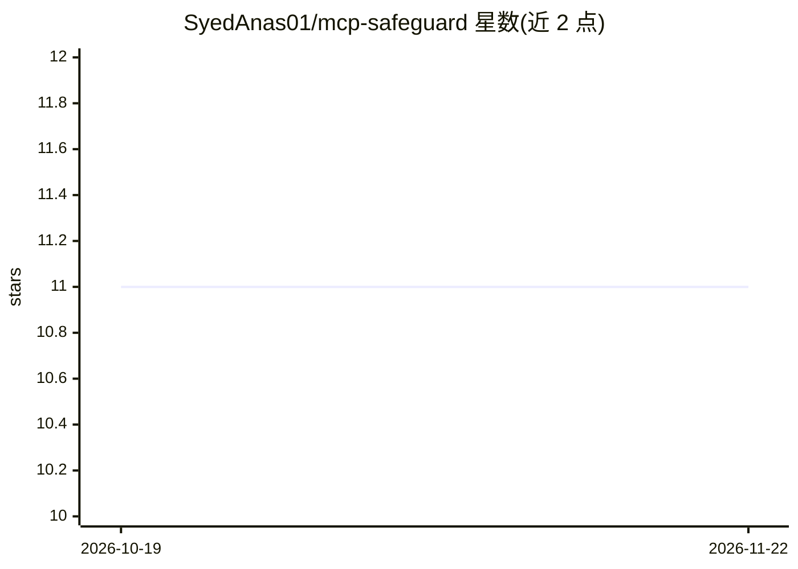

# SyedAnas01/mcp-safeguard

⭐ 11 · Python · MIT · 推送 2026-11-20 · [GitHub](https://github.com/SyedAnas01/mcp-safeguard) · [官网](https://syedanas01.github.io/mcp-safeguard) · 组织维护

**MCP 服务器安全扫描器：检测注入与凭据泄露**

面向 MCP（Model Context Protocol）服务器的安全扫描 CLI 工具，通过规则（如 TP-* 规则）检测 prompt injection、凭据泄露、端点暴露、tool poisoning 及源码级凭据处理缺陷等漏洞类别。以 Python 3.11+ 编写，通过 pip 安装，命令行传入服务器配置 JSON 文件即可扫描。维护者在 Cognivators 运营，配套公开漏洞记录文档 SECURITY-HALL-OF-SHAME.md，接受社区通过 GitHub Issues/Discussions 提交扫描结果。

## 筛选速览

| 维度 | 判定 | 备注 |
|---|---|---|
| AI 角色 | `ai-ecosystem` | LLM/agent 周边工具 |
| 许可风险 | `permissive` | MIT |
| 部署形态 | `library` | 以包/库形式分发 |
| 模型依赖 | — | README 未给出锁定关系 |
| 硬件要求 | — | 无带数字的原话,不猜 |
| 安装摩擦 | `low` | 无编译、无系统依赖或容器化 |
| 成熟度 | — | 结构信号不足 |

## 能力要点

- 检测 prompt injection、凭据泄露、SSRF、tool poisoning 等类别
- CLI 形式：mcp-safeguard scan + 配置 JSON
- 配套 SECURITY-HALL-OF-SHAME.md 漏洞模式文档
- 维护者报告的 CVE-2026-14540（Google MCP Toolbox SSRF）已由官方修复

## 适用场景

- 部署 MCP 服务器前扫描配置中的注入与凭据泄露风险
- 在 CI/DevOps 流水线中对 MCP 服务器做安全检查
- 提交真实扫描结果参与社区漏洞记录

## 场景标签

`网络安全` · 领域:学习与行业

## 证据(README 行号)

> L3: **The security scanner for MCP servers.**
> L5: Detect prompt injection · credential leaks · exposed endpoints · tool poisoning
> L21: mcp-safeguard scan your-config.json

## 星数曲线

2026-10-19 11 → 2026-11-22 11（+0）

---
*卡片 v1 · prompt 1.4 · 生成 2026-11-18 · 置信度 high · 依据 README sha `4d5050338022` · [字段定义](../../DATASET.md)*
