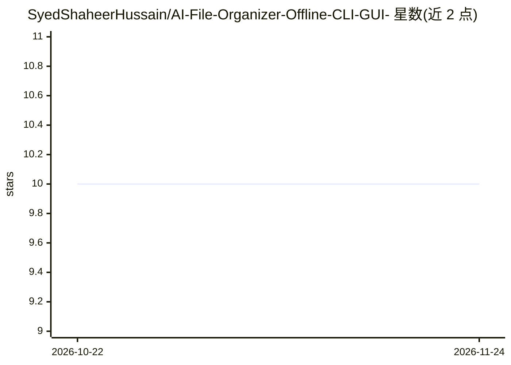

# SyedShaheerHussain/AI-File-Organizer-Offline-CLI-GUI-

⭐ 10 · Rust · MIT · 推送 2026-03-21 · [GitHub](https://github.com/SyedShaheerHussain/AI-File-Organizer-Offline-CLI-GUI-) · 个人维护

**AI 混合规则的 Rust 文件整理工具，供终端用户整理文件**

基于 Rust 的跨平台文件整理工具，提供 CLI 与 GUI（egui）两种界面。核心机制是混合分类策略：基于正则的确定性规则（JSON 配置可自定义）处理常见文件，无法覆盖的场景将文件名与元数据发送到 OpenAI（GPT-3.5/4）进行分类，也可用本地 ONNX Runtime 推理。功能包括并行哈希去重（BLAKE3）、EXIF/PDF 元数据读取分组、实时监视 Downloads 目录、.undo_history.json 快照的无限撤销与 dry-run 预览。AI 模式需 OPENAI_API_KEY；规则模式完全离线；重复删除不可逆，README 建议先备份。

## 筛选速览

| 维度 | 判定 | 备注 |
|---|---|---|
| AI 角色 | `ai-enhanced` | 去掉 AI 部分产品仍成立 |
| 许可风险 | `permissive` | MIT |
| 部署形态 | `None` |  |
| 模型依赖 | — | README 未给出锁定关系 |
| 硬件要求 | — | 无带数字的原话,不猜 |
| 安装摩擦 | `medium` | 含编译或系统依赖之一 |
| 成熟度 | `idea` | |

## 能力要点

- 确定性 JSON 规则 + OpenAI LLM / 本地 ONNX 的混合分类
- Rayon 并行哈希 + BLAKE3 去重
- .undo_history.json 快照撤销与 --dry-run 安全预览
- 实时监视目录并自动归档

## 适用场景

- 整理混乱的下载文件夹
- 摄影师批量归档 RAW 照片
- 清理重复文件释放磁盘空间

## 场景标签

`工作流自动化` · 领域:效率与自动化

## 证据(README 行号)

> L10: The **AI File Organizer** is a high-performance, cross-platform utility engineered to solve the "Digital Hoarding" 
> L52: 3. **LLM Classification**: Sends file context to OpenAI to categorize files rules can't catch (e.g., "Personal Note
> L96: # AI-powered organization (Requires OPENAI_API_KEY)

## 星数曲线

2026-10-22 10 → 2026-11-24 10（+0）

---
*卡片 v1 · prompt 1.4 · 生成 2026-11-20 · 置信度 high · 依据 README sha `530f0287a7e6` · [字段定义](../../DATASET.md)*
