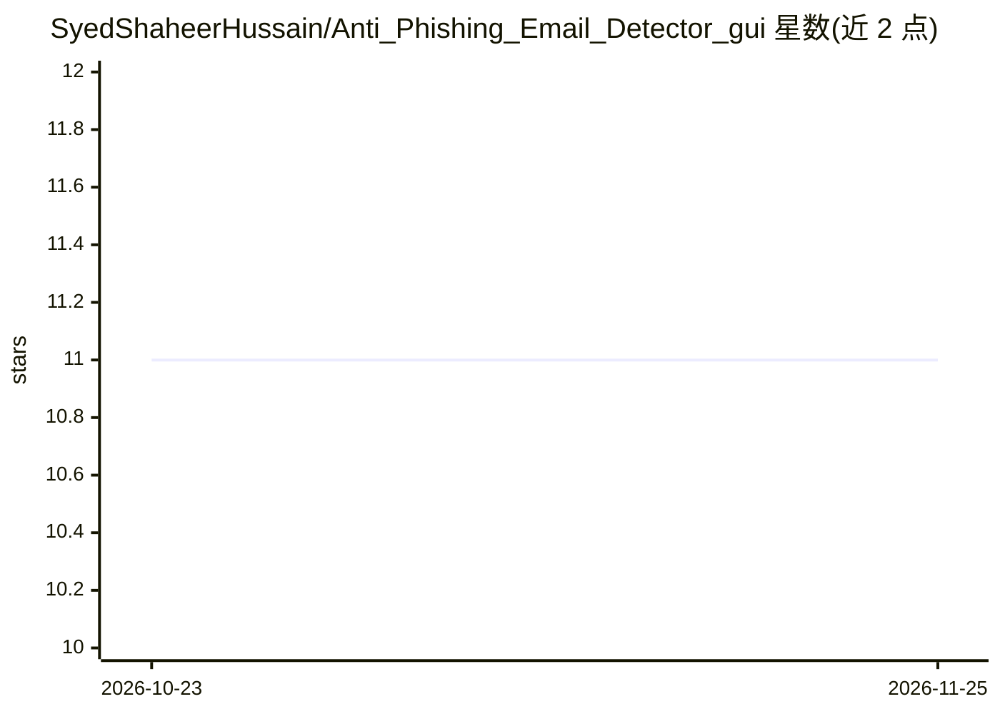

# SyedShaheerHussain/Anti_Phishing_Email_Detector_gui

⭐ 11 · Python · MIT · 推送 2026-02-22 · [GitHub](https://github.com/SyedShaheerHussain/Anti_Phishing_Email_Detector_gui) · 个人维护

**面向个人用户的钓鱼邮件检测 GUI 工具**

基于 Tkinter 的桌面应用，分析邮件正文、头部与链接识别钓鱼攻击：使用 Scikit-Learn 的 Random Forest 分类器，结合 NLP 关键词分析生成风险评分而非二元判断；结果经 SQLite 存储历史记录，并用 Matplotlib 输出 ROC/AUC、混淆矩阵等模型评估图表。需自备 phishing_dataset.csv 训练模型。README 声明仅用于教育与研究目的，准确度依赖数据集。

## 筛选速览

| 维度 | 判定 | 备注 |
|---|---|---|
| AI 角色 | `ai-native` | 本体是模型或模型工具 |
| 许可风险 | `permissive` | MIT |
| 部署形态 | `library` | 以包/库形式分发 |
| 模型依赖 | — | README 未给出锁定关系 |
| 硬件要求 | — | 无带数字的原话,不猜 |
| 安装摩擦 | `low` | 无编译、无系统依赖或容器化 |
| 成熟度 | — | 结构信号不足 |

## 能力要点

- 邮件内容、头部、URL 与 NLP 关键词四类检测并生成风险评分
- Random Forest 训练的 ML 模型与准确率评估
- SQLite 历史存储与 Tkinter 三标签页仪表盘
- Matplotlib 绘制 ROC/AUC 与混淆矩阵

## 适用场景

- 粘贴可疑邮件获取钓鱼判定与风险分数
- 查看历史分析记录与模型评估图表
- 机器学习安全检测的教学实践项目

## 场景标签

`网络安全` · 领域:学习与行业

## 证据(README 行号)

> L34: This project provides a **complete AI‑powered solution** to detect such phishing emails **before damage happens**.
> L157: 1. Email content analysis
> L245: ## 🌐 Chrome / Web Hosting?

## 星数曲线

2026-10-23 11 → 2026-11-25 11（+0）

---
*卡片 v1 · prompt 1.4 · 生成 2026-11-18 · 置信度 high · 依据 README sha `98e9b4a54583` · [字段定义](../../DATASET.md)*
