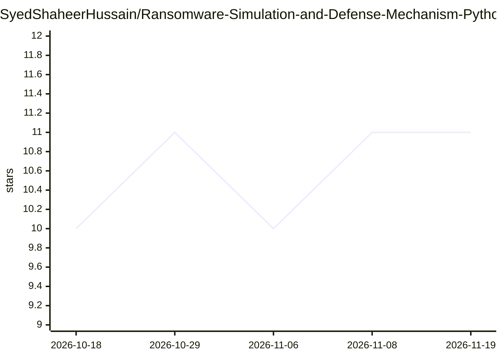

# SyedShaheerHussain/Ransomware-Simulation-and-Defense-Mechanism-Python-GUI

⭐ 11 · Python · MIT · 推送 2026-02-22 · [GitHub](https://github.com/SyedShaheerHussain/Ransomware-Simulation-and-Defense-Mechanism-Python-GUI) · 个人维护

**面向安全学习者的勒索软件模拟与防御教学沙盒**

基于 Python + PySide6 的教学型网络安全沙盒：在本地 sandbox 目录内用 Fernet 加密模拟勒索软件攻击（Burst/Stealth/Spray 三种模式），并部署多层防御——watchdog 文件行为监控、蜜罐诱饵文件、基于 Scikit-learn 的异常检测（CPU/IO 基线超 2.5 倍标准差告警）、TOTP 多因素认证、RBAC、密钥管理与恢复备份，另含取证内存转储与渗透扫描模块。明确声明仅用于教育与研究目的，不含真实恶意载荷。面向网络安全学生、SOC 分析师与安全爱好者。

## 筛选速览

| 维度 | 判定 | 备注 |
|---|---|---|
| AI 角色 | `ai-enhanced` | 去掉 AI 部分产品仍成立 |
| 许可风险 | `permissive` | MIT |
| 部署形态 | `library` | 以包/库形式分发 |
| 模型依赖 | — | README 未给出锁定关系 |
| 硬件要求 | — | 无带数字的原话,不猜 |
| 安装摩擦 | `low` | 无编译、无系统依赖或容器化 |
| 成熟度 | — | 结构信号不足 |

## 能力要点

- 三种模拟攻击模式：高速 Burst、低速 Stealth、随机 Spray
- AI 异常引擎基于 CPU/IO 基线偏离告警（Scikit-learn 模拟）
- watchdog 实时文件监控 + 蜜罐诱饵文件触发告警
- TOTP 多因素认证与 RBAC 角色权限控制敏感恢复操作

## 适用场景

- 安全课程中演示勒索软件加密与恢复全流程
- 练习蓝队行为监控与异常检测告警响应
- 学习对称加密、密钥生命周期与 MFA 机制
- 取证实验中分析攻击过程的内存转储数据

## 场景标签

`网络安全` `教程课程` · 领域:学习与行业

## 证据(README 行号)

> L3: > **One-line Description**: A high-fidelity, educational cybersecurity sandbox for simulating ransomware attacks and
> L108: - **`cyber_lab/core/`**: The "Brain" - holds encryption logic, AI engines, and security protocols.
> L120: |**AI**|Scikit-learn (Simulated)|Anomaly detection and baseline profiling.|
> L144: - **Behavior Monitoring**: Real-time file system watchers (`watchdog`) detect unauthorized changes.

## 星数曲线

2026-10-18 10 → 2026-11-19 11（+1）

---
*卡片 v1 · prompt 1.4 · 生成 2026-11-18 · 置信度 mid · 依据 README sha `b329829d43b5` · [字段定义](../../DATASET.md)*
