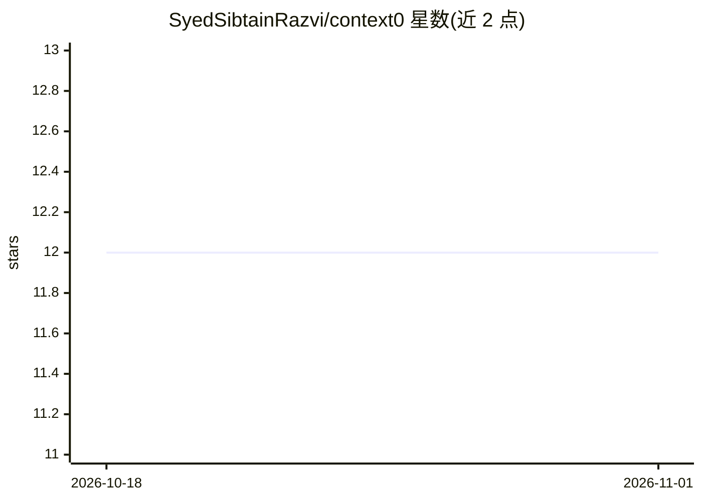

# SyedSibtainRazvi/context0

⭐ 12 · Rust · MIT · 推送 2026-04-09 · [GitHub](https://github.com/SyedSibtainRazvi/context0) · [官网](https://context-0.vercel.app/) · 个人维护

**为 AI 编程 agent 保存/恢复分支级会话交接状态的 CLI 与 MCP 工具**

面向 AI 编程 agent（Claude Code、Cursor、Codex）的会话状态检查点工具：像 git stash 一样，按 git 仓库+分支作用域保存交接状态（已完成事项、下一步、阻塞项、测试状态、关键文件、commit SHA），下次会话由 agent 自动加载恢复。通过 MCP 自动触发，也可用 CLI 手动 save/resume；数据存于本地 SQLite，无云端、无登录。curl 脚本安装二进制，支持 macOS（Intel/Apple Silicon）与 Linux（x86_64/arm64），Windows 从 Releases 下载 zip。明确不做长期项目记忆或完整对话回放。

## 筛选速览

| 维度 | 判定 | 备注 |
|---|---|---|
| AI 角色 | `ai-ecosystem` | LLM/agent 周边工具 |
| 许可风险 | `permissive` | MIT |
| 部署形态 | `desktop` | 安装包/桌面程序 |
| 模型依赖 | — | README 未给出锁定关系 |
| 硬件要求 | — | 无带数字的原话,不猜 |
| 安装摩擦 | `low` | 无编译、无系统依赖或容器化 |
| 成熟度 | — | 结构信号不足 |

## 能力要点

- 按 git 仓库+分支作用域的检查点保存与恢复
- MCP 配置后由 agent 自动保存/加载，无需手动命令
- 本地 SQLite 存储（~/.context0/context0.db），无云端无依赖
- 写入 CLAUDE.md / .cursor/rules / AGENTS.md 等规则文件驱动自动行为

## 适用场景

- 切换 AI 编程工具或隔天续作时恢复上下文
- token 用尽或新会话冷启动时交接任务状态
- 多分支并行任务各自保持独立上下文

## 场景标签

`Agent 记忆` · 领域:Agent 开发

## 证据(README 行号)

> L3: Ephemeral branch-scoped handoff state for AI coding agents. Like `git stash`, but for your agent's working memory.
> L40: ## How it works (automatic with MCP)

## 星数曲线

2026-10-18 12 → 2026-11-01 12（+0）

---
*卡片 v1 · prompt 1.4 · 生成 2026-11-01 · 置信度 high · 依据 README sha `51ee5626d815` · [字段定义](../../DATASET.md)*
