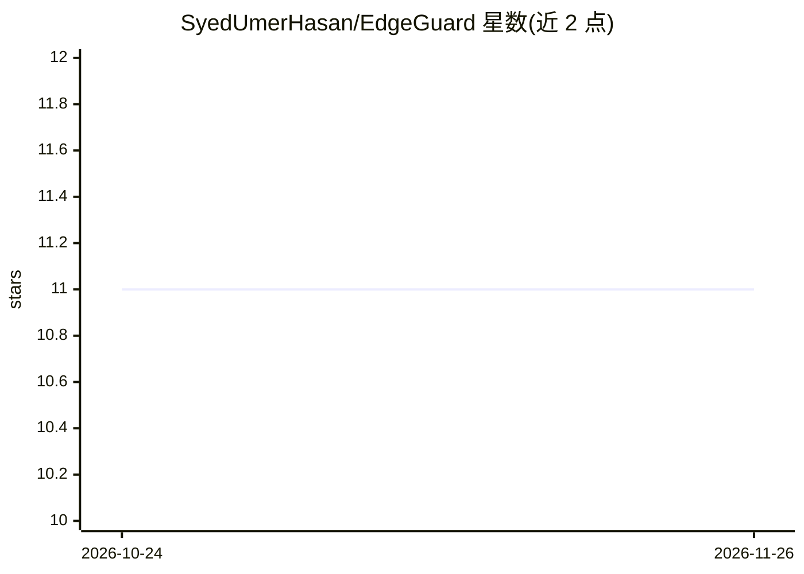

# SyedUmerHasan/EdgeGuard

⭐ 11 · Python · MIT · 推送 2026-02-07 · [GitHub](https://github.com/SyedUmerHasan/EdgeGuard) · [官网](https://syedumerhasan.github.io/EdgeGuard/) · 个人维护

**家庭网络的本地 AI 威胁检测网关**

EdgeGuard 抓取家庭网络中的数据包元数据，调用本地运行的 Ollama + Llama 3.2 模型分析流量模式，检测针对 IoT 设备和智能手机的可疑活动。所有分析在本地完成，不向云端发送数据。运行需 Python 3.8+、Ollama（llama3.2:3b 模型）及 sudo 权限，硬件上支持 Raspberry Pi 或旧笔记本，以 MIT 许可开源。

## 筛选速览

| 维度 | 判定 | 备注 |
|---|---|---|
| AI 角色 | `ai-native` | 本体是模型或模型工具 |
| 许可风险 | `permissive` | MIT |
| 部署形态 | `None` |  |
| 模型依赖 | local-ok | 支持本地模型 |
| 硬件要求 | — | 无带数字的原话,不猜 |
| 安装摩擦 | `low` | 无编译、无系统依赖或容器化 |
| 成熟度 | — | 结构信号不足 |

## 能力要点

- 本地 LLM（Ollama + Llama 3.2）分析网络流量模式
- 数据不外发云端，全程本地分析
- 可运行于 Raspberry Pi 等低成本硬件
- 抓取数据包元数据检测 IoT 威胁

## 适用场景

- 在家庭网络中监控 IoT 设备的可疑流量
- 用 Raspberry Pi 搭建本地隐私优先的威胁检测
- 检测针对手机与 IoT 设备的僵尸网络活动

## 场景标签

`网络安全` · 领域:学习与行业

## 证据(README 行号)

> L3: A lightweight, privacy-preserving AI tool that monitors home network traffic to detect IoT threats using local LLM a
> L7: EdgeGuard captures network packet metadata and uses a local AI model (Ollama + Llama 3.2) to analyze traffic pattern

## 星数曲线

2026-10-24 11 → 2026-11-26 11（+0）

---
*卡片 v1 · prompt 1.4 · 生成 2026-11-18 · 置信度 high · 依据 README sha `e02c3e0c5b20` · [字段定义](../../DATASET.md)*
