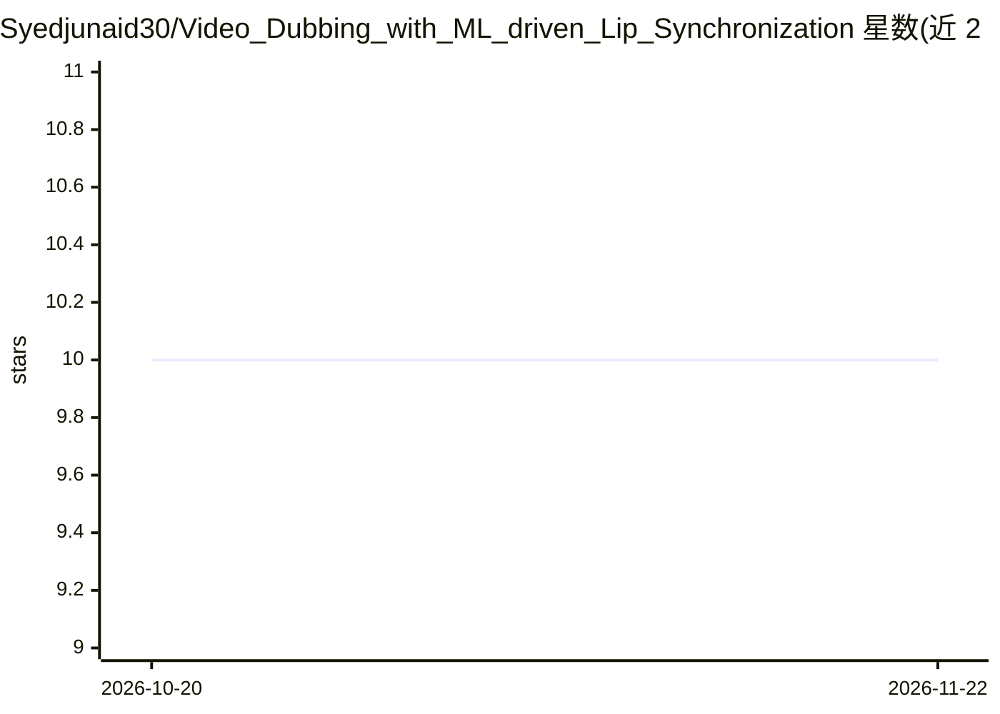

# Syedjunaid30/Video_Dubbing_with_ML_driven_Lip_Synchronization

⭐ 10 · Jupyter Notebook · MIT · 推送 2026-03-04 · [GitHub](https://github.com/Syedjunaid30/Video_Dubbing_with_ML_driven_Lip_Synchronization) · 个人维护

**多语言视频配音工具：翻译语音并生成对口型画面**

基于 Flask 的 Web 视频配音系统：用户上传视频后，将语音翻译为目标语言（Google Translate API），用 gTTS 或 pyttsx3 生成配音，再以 Wav2Lip 预训练模型驱动口型与配音同步，FFmpeg 与 OpenCV 完成视频处理。支持印地语、法语、德语、西班牙语四种语言。模型需从 Wav2Lip 官方仓库另行下载放入 checkpoints 目录；另提供含模型与脚本的 Dropbox ZIP 打包下载。

## 筛选速览

| 维度 | 判定 | 备注 |
|---|---|---|
| AI 角色 | `ai-native` | 本体是模型或模型工具 |
| 许可风险 | `permissive` | MIT |
| 部署形态 | `library` | 以包/库形式分发 |
| 模型依赖 | — | README 未给出锁定关系 |
| 硬件要求 | — | 无带数字的原话,不猜 |
| 安装摩擦 | `medium` | 含编译或系统依赖之一 |
| 成熟度 | — | 结构信号不足 |

## 能力要点

- 语音翻译、TTS 配音与 Wav2Lip 口型同步的完整流水线
- 支持印地语、法语、德语、西班牙语四种语言
- Flask Web 界面上传并配音视频
- 提供含模型与脚本的预打包 ZIP 下载

## 适用场景

- 将视频配音翻译成印地语/法语/德语/西班牙语
- 为翻译后的配音生成匹配的口型同步画面
- 本地部署一个网页端配音工具

## 场景标签

`语音合成` `图像视频处理` `多模态` · 领域:内容生成

## 证据(README 行号)

> L3: An intelligent video dubbing system powered by **deep learning** that enables users to dub a video in multiple langu
> L24: - Sync the new voice to the speaker’s lips using deep learning.

## 星数曲线

2026-10-20 10 → 2026-11-22 10（+0）

---
*卡片 v1 · prompt 1.4 · 生成 2026-11-20 · 置信度 high · 依据 README sha `3dcfaf9c33e9` · [字段定义](../../DATASET.md)*
