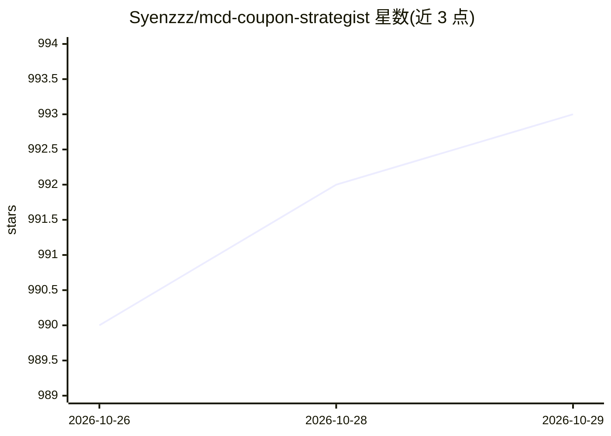

# Syenzzz/mcd-coupon-strategist

⭐ 993 · Python · MIT · 推送 2026-10-21 · [GitHub](https://github.com/Syenzzz/mcd-coupon-strategist) · [官网](https://github.com/Ayzzz123/mcd-coupon-strategist/blob/main/MCP_INTEGRATION.md) · 个人维护 · 中文 README

**基于麦当劳中国 MCP 的点餐省钱技能：算最省方案与券流失**

面向麦当劳中国用户的点餐成本优化 MCP Skill，通过 WorkBuddy 等客户端接入：链路 A 枚举单品/套餐/券/凑单组合并全部经 MCP calculate-price 真实计价，输出当前门店最省方案并检测凑单陷阱；链路 B 读取历史订单与券存量，输出券的沉默成本、消费习惯画像、券包净价值体检、用券排程、可领取券发现与积分体检。零第三方依赖，demo.py 用录制的 MCP 响应离线跑通全链路，测试无需 Token。领券等写操作需用户明确同意。

## 筛选速览

| 维度 | 判定 | 备注 |
|---|---|---|
| AI 角色 | `ai-ecosystem` | LLM/agent 周边工具 |
| 许可风险 | `permissive` | MIT |
| 部署形态 | `None` |  |
| 模型依赖 | — | README 未给出锁定关系 |
| 硬件要求 | — | 无带数字的原话,不猜 |
| 安装摩擦 | `low` | 无编译、无系统依赖或容器化 |
| 成熟度 | — | 结构信号不足 |

## 能力要点

- 所有候选方案经 MCP calculate-price 真实计价，不用模型估算价格
- 券的沉默成本：量化即将过期券的面值与净价值（顺手可用/努一把/纸面富贵/无法判断四类）
- 用券排程：在「券过期前还会点几单」约束下分配券，检测注定浪费部分
- 零第三方依赖、纯本地测试无需 MCP Token；区分消费/点单两种客单价口径

## 适用场景

- 点餐前算出当前门店预算内最省的组合并对比方案
- 查看手里哪些券快过期、哪几张不值得凑单使用
- 从历史订单了解自己在麦当劳的月度支出结构
- 发现还没领取的券并判断哪张值得领

## 场景标签

 · 领域:生活服务/消费优化

## 证据(README 行号)

> L17: 基于麦当劳中国 MCP 打造的点餐成本助手，做两件事：
> L315: ### 3. 在 WorkBuddy 中启用
> L411: - 🧩 **你在写 Agent / Skill 的评测** —— 这个项目是一个完整的、双链路的 MCP 编排示例，`saver.py` + `auditor.py` + `mcd_adapter.py` 分层清晰，可直接作为参

## 星数曲线

2026-10-26 990 → 2026-10-29 993（+3）

---
*卡片 v1 · prompt 1.4 · 生成 2026-10-27 · 置信度 high · 依据 README sha `3a40f8106cea` · [字段定义](../../DATASET.md)*
