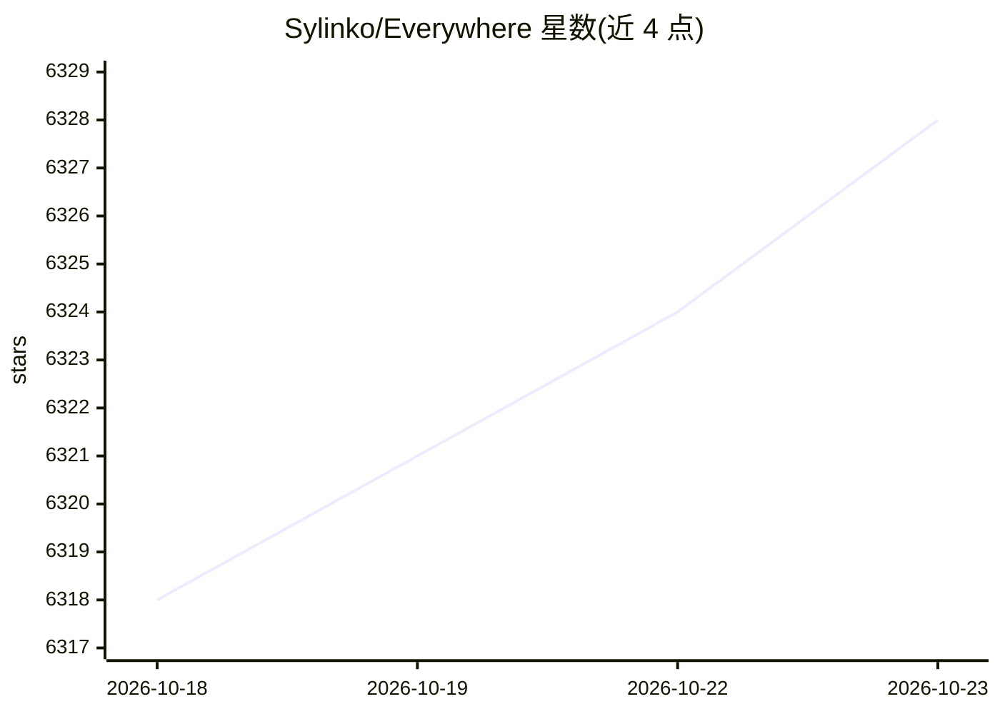

# Sylinko/Everywhere

⭐ 6,328 · C# · NOASSERTION · 推送 2026-10-22 · [GitHub](https://github.com/Sylinko/Everywhere) · [官网](https://everywhere.sylinko.com) · 组织维护 · 中文 README

**屏幕感知的桌面 AI 助手：随时唤起，跨应用读取上下文辅助操作**

面向桌面用户的上下文感知 AI 助手应用（.NET 10 + Avalonia 构建）。通过快捷键唤起悬浮窗，结合无障碍 API 与 UI 自动化提取当前屏幕/应用的上下文，直接就错误信息、网页、选中文本提问并获取回答或翻译。模型生态接入 Everywhere Cloud、OpenAI、Anthropic、Gemini、DeepSeek、Moonshot、MiniMax、Ollama 及自定义 API 端点；Agent 系统含浏览器、子代理分发、本地文件系统、终端脚本执行、MCP 工具与记忆系统。支持 Windows/macOS（Linux 开发中）、多语言界面；策略引擎与部分功能标注为开发中。Windows/macOS 提供安装包与便携版。

## 筛选速览

| 维度 | 判定 | 备注 |
|---|---|---|
| AI 角色 | `ai-native` | 本体是模型或模型工具 |
| 许可风险 | `none` | NOASSERTION |
| 部署形态 | `desktop` | 安装包/桌面程序 |
| 模型依赖 | local-ok | 支持本地模型 |
| 硬件要求 | — | 无带数字的原话,不猜 |
| 安装摩擦 | `medium` | 含编译或系统依赖之一 |
| 成熟度 | — | 结构信号不足 |

## 能力要点

- 通过快捷键唤起并即时感知当前屏幕/应用上下文，无需截图或复制
- 支持 8 类模型来源（OpenAI/Anthropic/Gemini/DeepSeek/Moonshot/MiniMax/Ollama/自定义端点）
- Agent 系统含浏览器、子代理、本地文件系统、终端执行、MCP 工具、记忆系统
- Windows/macOS 提供安装包与便携版，多语言界面（含简繁中文）

## 适用场景

- 遇到报错弹窗时直接询问原因与解法
- 浏览长文时划选文本即时摘要或翻译
- 在邮件草稿上让 AI 润色措辞、核验信息真实性

## 场景标签

`AI 助手` · 领域:对话与助手

## 证据(README 行号)

> L30: **Everywhere** is an interactive AI assistant with context-aware capabilities, featuring a sleek, modern UI and pow
> L64:  • Everywhere Cloud Service
> L115: - **👁️ Broad Context Awareness**: In addition to supporting traditional screen multi-modality, we have deeply inte

## 星数曲线

2026-10-18 6,318 → 2026-10-23 6,328（+10）

---
*卡片 v1 · prompt 1.4 · 生成 2026-10-20 · 置信度 high · 依据 README sha `f9a1ed2b9934` · [字段定义](../../DATASET.md)*
