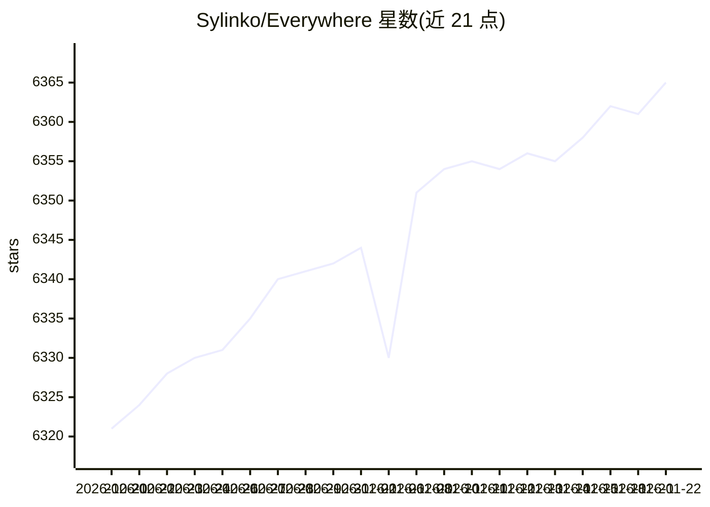

# Sylinko/Everywhere

⭐ 6,365 · C# · NOASSERTION · 推送 2026-11-21 · [GitHub](https://github.com/Sylinko/Everywhere) · [官网](https://everywhere.sylinko.com) · 组织维护 · 中文 README

**桌面屏上下文感知 AI 助手，跨应用快捷调用**

基于 .NET/Avalonia 的桌面交互式 AI 助手，可感知屏幕内容：用户无需截图或复制，按快捷键即可针对当前应用上下文提问、总结、翻译、改写邮件或核验信息。技术架构包括底层无障碍 API 与 UI 自动化以提取结构化环境数据、Agent 系统（浏览器、子代理、本地文件、终端脚本、MCP 工具）、全局热键与划词交互。提供 Windows 与 macOS 安装包/便携包，Linux 开发中，支持 10 种界面语言。

## 筛选速览

| 维度 | 判定 | 备注 |
|---|---|---|
| AI 角色 | `ai-native` | 本体是模型或模型工具 |
| 许可风险 | `none` | NOASSERTION |
| 部署形态 | `desktop` | 安装包/桌面程序 |
| 模型依赖 | local-ok | 支持本地模型 |
| 硬件要求 | — | 无带数字的原话,不猜 |
| 安装摩擦 | `medium` | 含编译或系统依赖之一 |
| 成熟度 | — | 结构信号不足 |

## 能力要点

- 屏幕上下文感知：结合多模态与无障碍 API 提取当前应用结构化数据
- 支持多家 LLM 服务及 Ollama 本地部署、自定义 API 端点
- Agent 工具：浏览器、子代理、本地文件、终端脚本、MCP、系统应用集成
- 全局快捷键、划词交互与磨砂玻璃 UI

## 适用场景

- 对屏幕上的报错信息直接询问解决方法
- 对长网页文章一键获取要点摘要
- 划词即时翻译文献中的外文内容
- 检查可疑信息的真实性

## 场景标签

`AI 助手` · 领域:对话与助手

## 证据(README 行号)

> L30: **Everywhere** is an interactive AI assistant with context-aware capabilities, featuring a sleek, modern UI and pow
> L115: - **👁️ Broad Context Awareness**: In addition to supporting traditional screen multi-modality, we have deeply inte

## 星数曲线

2026-10-20 6,321 → 2026-11-22 6,365（+44）

---
*卡片 v1 · prompt 1.4 · 生成 2026-11-22 · 置信度 high · 依据 README sha `f18d0ea0dd0a` · [字段定义](../../DATASET.md)*
