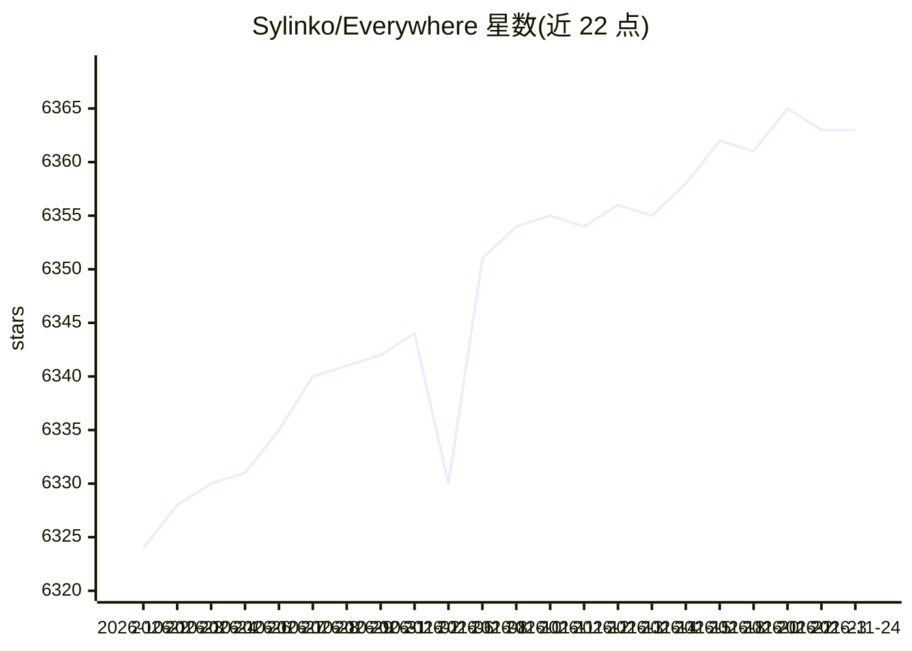

# Sylinko/Everywhere

⭐ 6,364 · C# · AGPL-3.0 · 推送 2026-11-23 · [GitHub](https://github.com/Sylinko/Everywhere) · [官网](https://everywhere.sylinko.com) · 组织维护 · 中文 README

**桌面屏幕感知 AI 助手：快捷键就地调用多模型与 MCP 工具**

基于 Avalonia/.NET 的桌面 AI 助手，感知当前屏幕内容并在应用内就地响应：无需截图或复制，快捷键唤起后捕获上下文并输出解答、摘要、翻译或改写。模型侧提供云服务及 OpenAI、Anthropic、Google、DeepSeek、Moonshot、MiniMax、Ollama 接入与自定义 API 端点；Agent 系统支持网页浏览、子代理派发、本地文件系统、终端脚本执行与 MCP 工具，并集成了 Windows 上基于 Everything 的快速搜索等系统能力。提供 Windows 安装包与便携 zip、macOS pkg，Linux 正在开发。

## 筛选速览

| 维度 | 判定 | 备注 |
|---|---|---|
| AI 角色 | `ai-native` | 本体是模型或模型工具 |
| 许可风险 | `dual` | AGPL-3.0 |
| 部署形态 | `desktop` | 安装包/桌面程序 |
| 模型依赖 | local-ok | 支持本地模型 |
| 硬件要求 | — | 无带数字的原话,不猜 |
| 安装摩擦 | `medium` | 含编译或系统依赖之一 |
| 成熟度 | — | 结构信号不足 |

## 能力要点

- 屏幕上下文感知：整合底层 accessibility API 与 UI 自动化提取结构化环境数据
- 多模型接入列表含 Ollama 本地部署与自定义 API 端点
- Agent 系统：网页浏览、子代理派发、本地文件、终端脚本、MCP 工具
- Windows/macOS 安装包与便携包，多语言界面

## 适用场景

- 遇到报错时快捷键唤起助手就地解释并给出解决方案
- 浏览长文时生成要点摘要，或就地翻译选中文本
- 让助手直接改写邮件草稿的语气与措辞
- 通过 MCP 工具与本地文件、终端脚本联动完成任务

## 场景标签

`AI 助手` · 领域:对话与助手

## 证据(README 行号)

> L30: **Everywhere** is an interactive AI assistant with context-aware capabilities, featuring a sleek, modern UI and pow
> L64:  • Everywhere Cloud Service
> L115: - **👁️ Broad Context Awareness**: In addition to supporting traditional screen multi-modality, we have deeply inte

## 星数曲线

2026-10-22 6,324 → 2026-11-24 6,363（+39）

---
*卡片 v1 · prompt 1.4 · 生成 2026-11-23 · 置信度 high · 依据 README sha `731333ac235d` · [字段定义](../../DATASET.md)*
