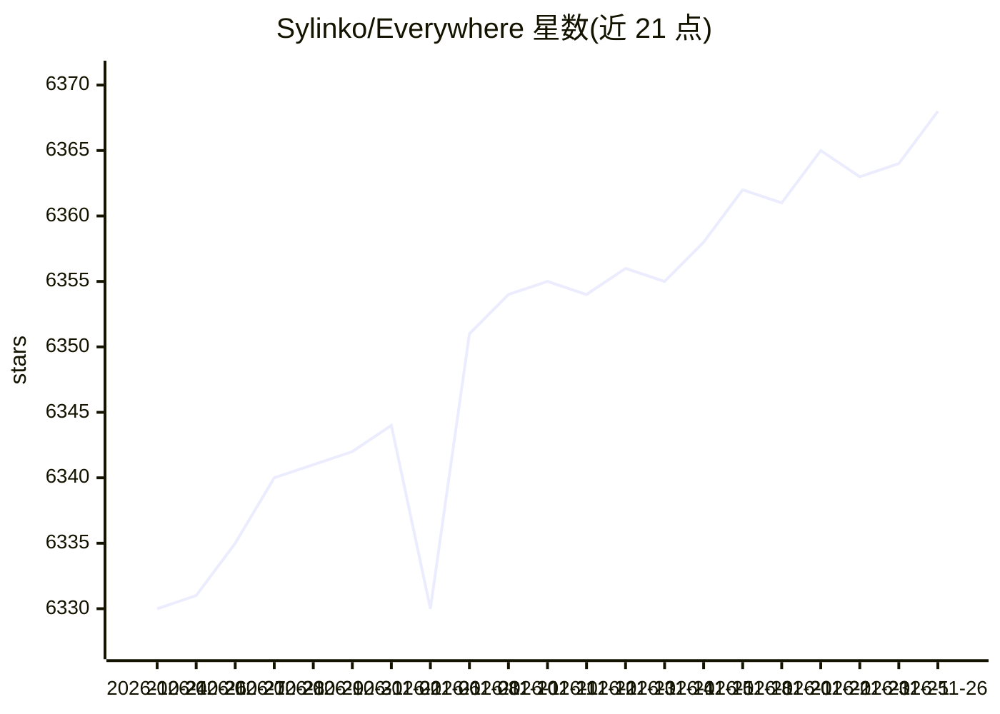

# Sylinko/Everywhere

⭐ 6,368 · C# · AGPL-3.0 · 推送 2026-11-25 · [GitHub](https://github.com/Sylinko/Everywhere) · [官网](https://everywhere.sylinko.com) · 组织维护 · 中文 README

**屏幕感知桌面 AI 助手：就地调用 LLM 处理当前上下文**

基于 .NET/Avalonia 的桌面 AI 助手，通过底层辅助功能 API 与 UI 自动化提取当前屏幕与活动应用的结构化上下文，用户按快捷键即可在原地对可见内容提问、摘要、翻译、改写或核实信息。支持多家 LLM 云服务、Ollama 本地部署与自定义 API 端点，Agent 系统提供浏览器、本地文件系统、终端脚本、MCP 工具与子 Agent 调度。提供 Windows/macOS 安装包，Linux 由社区维护。

## 筛选速览

| 维度 | 判定 | 备注 |
|---|---|---|
| AI 角色 | `ai-native` | 本体是模型或模型工具 |
| 许可风险 | `dual` | AGPL-3.0 |
| 部署形态 | `desktop` | 安装包/桌面程序 |
| 模型依赖 | local-ok | 支持本地模型 |
| 硬件要求 | — | 无带数字的原话,不猜 |
| 安装摩擦 | `medium` | 含编译或系统依赖之一 |
| 成熟度 | — | 结构信号不足 |

## 能力要点

- 屏幕感知：无需截图/复制/切换应用，快捷键就地获取 AI 帮助
- 多模型接入：OpenAI/Anthropic/Gemini/DeepSeek/Moonshot/MiniMax/Ollama 及自定义端点
- Agent 工具：浏览器、子 Agent、本地文件、终端脚本、MCP、Everything 搜索
- 跨平台：Windows/macOS 官方支持，Linux 社区维护

## 适用场景

- 对着屏幕上的报错信息直接问原因和解决办法
- 浏览长文章时快捷键生成要点摘要
- 选中文本即时翻译或改写邮件措辞
- 对可疑信息做快速检索核实

## 场景标签

`AI 助手` · 领域:对话与助手

## 证据(README 行号)

> L30: **Everywhere** is an interactive AI assistant with context-aware capabilities, featuring a sleek, modern UI and pow
> L116: - **👁️ Broad Context Awareness**: In addition to supporting traditional screen multi-modality, we have deeply inte
> L62:  🤖 Rich Model Ecosystem

## 星数曲线

2026-10-24 6,330 → 2026-11-26 6,368（+38）

---
*卡片 v1 · prompt 1.4 · 生成 2026-11-26 · 置信度 high · 依据 README sha `b459d730e278` · [字段定义](../../DATASET.md)*
