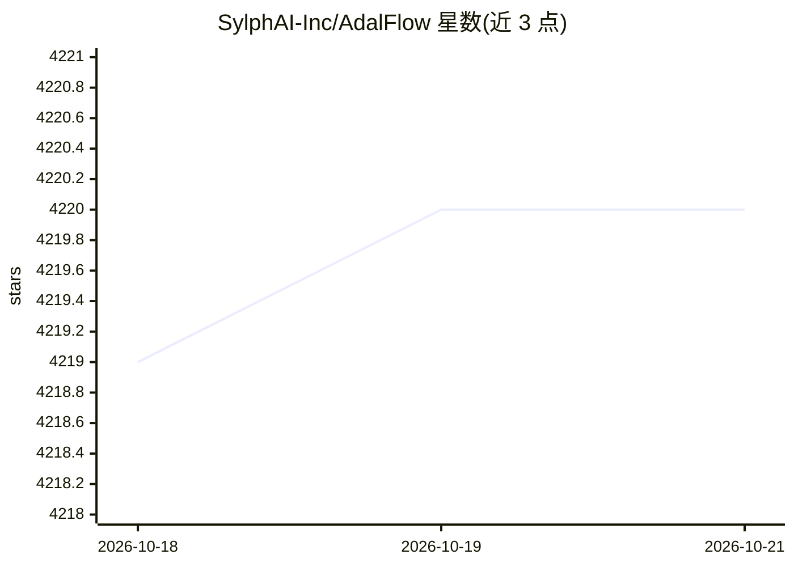

# SylphAI-Inc/AdalFlow

⭐ 4,220 · Python · MIT · 推送 2026-05-29 · [GitHub](https://github.com/SylphAI-Inc/AdalFlow) · [官网](http://adalflow.sylph.ai/) · 组织维护

**构建并自动优化 LLM 应用工作流的 PyTorch 风格库**

面向开发者的 LLM 应用构建框架：提供模型无关的构建块（Parameter/Generator/AdalComponent/Trainer），覆盖 Chatbot、RAG、Agent 及经典 NLP 任务。核心机制是类 PyTorch 的自动微分式提示优化，统一零样本与少样本提示优化于同一训练循环，并内置 Human-in-the-Loop 与 Tracing，无需额外 API。以 pip 安装的 Python 库形式提供，附 Colab 快速上手与 CLI 产品 AdaL。与 UT Austin VITA Group 有研究合作。

## 筛选速览

| 维度 | 判定 | 备注 |
|---|---|---|
| AI 角色 | `ai-ecosystem` | LLM/agent 周边工具 |
| 许可风险 | `permissive` | MIT |
| 部署形态 | `library` | 以包/库形式分发 |
| 模型依赖 | — | README 未给出锁定关系 |
| 硬件要求 | — | 无带数字的原话,不猜 |
| 安装摩擦 | `low` | 无编译、无系统依赖或容器化 |
| 成熟度 | — | 结构信号不足 |

## 能力要点

- 模型无关的 LLM 任务流水线构建块，配置切换底层模型
- PyTorch 式自动微分框架统一零样本/少样本提示优化
- 内置 Human-in-the-Loop 与 Tracing，无需额外 API
- 同步/异步/流式三种 Agent 调用模式

## 适用场景

- 构建聊天机器人、RAG 或 Agent 类 LLM 应用
- 自动优化提示词替代手工调 prompt
- 在统一训练循环中做少样本提示优化

## 场景标签

`提示工程` `RAG` `Agent 框架` · 领域:Agent 开发

## 证据(README 行号)

> L1: ⚡ AdalFlow is a PyTorch-like library to build and auto-optimize any LM workflows, from Chatbots, RAG, to Agents. ⚡
> L39: 2. **Say goodbye to manual prompting**: AdalFlow provides a unified auto-differentiative framework for both zero-sh

## 星数曲线

2026-10-18 4,219 → 2026-10-21 4,220（+1）

---
*卡片 v1 · prompt 1.4 · 生成 2026-10-21 · 置信度 high · 依据 README sha `ab2b20bbc63e` · [字段定义](../../DATASET.md)*
