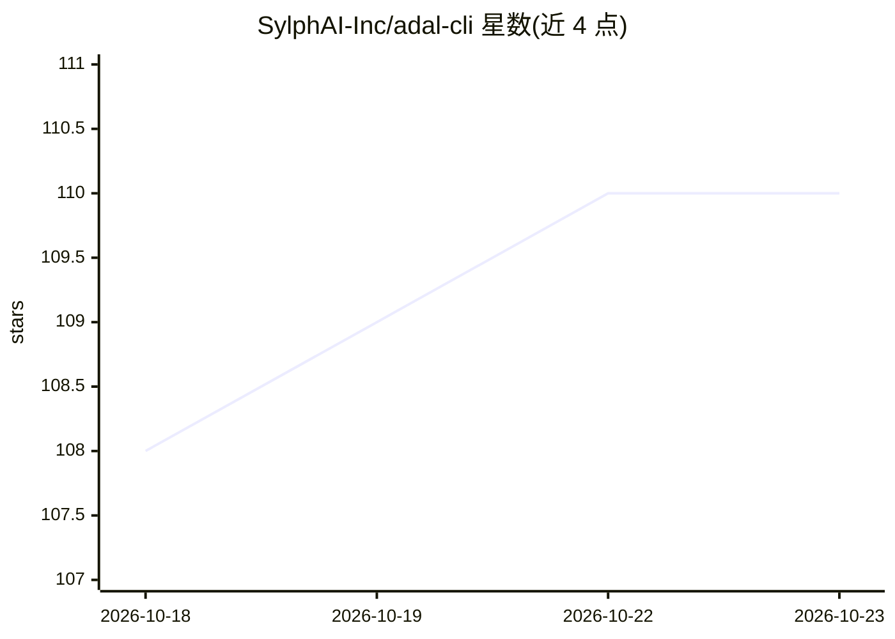

# SylphAI-Inc/adal-cli

⭐ 110 · HTML · 推送 2026-09-22 · [GitHub](https://github.com/SylphAI-Inc/adal-cli) · [官网](https://docs.sylph.ai/) · 组织维护

**终端原生的 AI agent 编排框架，面向开发者自动化编码与工作流**

由 SylphAI 开发的命令行 agent harness，将 AI 模型、agent 与工具编排为端到端工作流，从 issue 到测试通过的 PR。支持 Claude、GPT、Gemini、GLM、Kimi、DeepSeek、MiniMax 及本地模型切换；提供 MCP 服务器接入、浏览器操控、图像生成分析、Headless 模式与 Cron 调度。技能以 Markdown 文件形式扩展，通过插件市场安装。本仓库为社区版，含安装脚本（macOS/Linux/WSL curl、Windows PowerShell/CMD），首次运行需浏览器认证。

## 筛选速览

| 维度 | 判定 | 备注 |
|---|---|---|
| AI 角色 | `ai-ecosystem` | LLM/agent 周边工具 |
| 许可风险 | `none` | — |
| 部署形态 | `None` |  |
| 模型依赖 | — | README 未给出锁定关系 |
| 硬件要求 | — | 无带数字的原话,不猜 |
| 安装摩擦 | `low` | 无编译、无系统依赖或容器化 |
| 成熟度 | — | 结构信号不足 |

## 能力要点

- 终端原生运行，支持多模型切换（Claude/GPT/Gemini/GLM/Kimi/DeepSeek/MiniMax/本地模型）
- 工具调用、文件编辑与 diff 可审查后再确认
- 支持 MCP Servers、浏览器操控、Headless 模式与 Cron 调度
- 技能以 Markdown 文件定义，经插件市场一键安装

## 适用场景

- 在终端中让 AI agent 端到端完成编码任务（issue 到 PR）
- 编写可复用技能分享工作流给团队或社区
- 通过 Headless 模式与 Cron 在 CI 中运行 agent 任务

## 场景标签

`Agent 框架` `编码 Agent` · 领域:Agent 开发

## 证据(README 行号)

> L22: AdaL is your automation-first agent harness — every coding agent can build, but only AdaL does GTM directly from yo
> L24: AdaL CLI is a terminal-native harness that orchestrates AI agents, models, and tools into autonomous, end-to-end wo

## 星数曲线

2026-10-18 108 → 2026-10-23 110（+2）

---
*卡片 v1 · prompt 1.4 · 生成 2026-10-23 · 置信度 high · 依据 README sha `64232a7343c0` · [字段定义](../../DATASET.md)*
