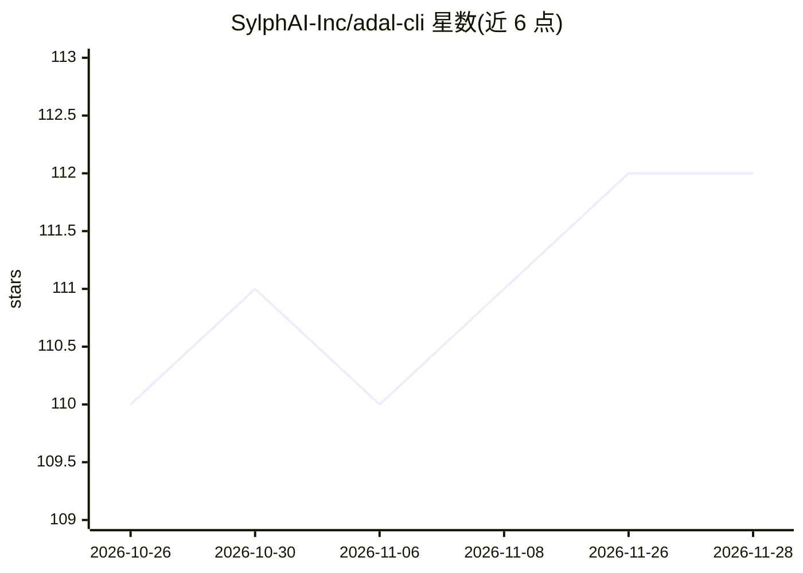

# SylphAI-Inc/adal-cli

⭐ 112 · HTML · 推送 2026-11-17 · [GitHub](https://github.com/SylphAI-Inc/adal-cli) · [官网](https://docs.sylph.ai/) · 组织维护

**终端里的视频 AI agent CLI：生成宣传片、产品演示与 UGC 广告**

AdaL 的终端版本，将 agents、模型与工具编排为端到端工作流，根据用户描述生成 launch films、产品演示、UGC 广告、播客片段和活动回顾，输出可直接编辑的成品；也可用于编码任务。提供模型切换命令面板、可审查的工具调用、会话记忆与恢复、CLI 到 IDE 的会话交接。通过安装脚本在 macOS/Linux/WSL/Windows 安装，首次运行需浏览器认证；技能以 markdown 文件形式经插件市场安装扩展。

## 筛选速览

| 维度 | 判定 | 备注 |
|---|---|---|
| AI 角色 | `ai-native` | 本体是模型或模型工具 |
| 许可风险 | `none` | — |
| 部署形态 | `None` |  |
| 模型依赖 | — | README 未给出锁定关系 |
| 硬件要求 | — | 无带数字的原话,不猜 |
| 安装摩擦 | `low` | 无编译、无系统依赖或容器化 |
| 成熟度 | — | 结构信号不足 |

## 能力要点

- 生成 launch films、产品演示、UGC 广告、播客片段等视频内容
- 支持 Claude、GPT、Gemini、GLM、Kimi、DeepSeek、MiniMax 及本地模型的切换
- 工具调用、文件编辑与 diff 保持可见的 review-first 交互
- 技能（markdown 文件）可经插件市场一键安装与社区贡献

## 适用场景

- 从命令行脚本化批量产出产品宣传与广告视频
- 在终端中使用多模型 agent 完成编码任务
- 用可复用技能封装并分享团队的视频制作流程

## 场景标签

`视频生成` `编码 Agent` · 领域:编码与开发

## 证据(README 行号)

> L22: AdaL is an AI agent for video. You tell it what you need and it makes launch films, product demos, UGC ads, podcast
> L24: AdaL CLI is the terminal version. It orchestrates agents, models and tools into end-to-end workflows, so you can sc

## 星数曲线

2026-10-26 110 → 2026-11-28 112（+2）

---
*卡片 v1 · prompt 1.4 · 生成 2026-11-28 · 置信度 high · 依据 README sha `f853bc699231` · [字段定义](../../DATASET.md)*
