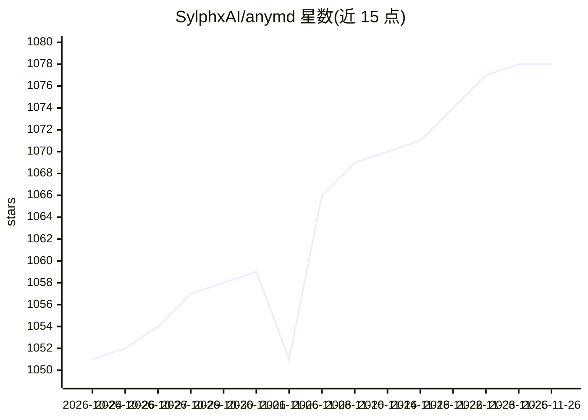

# SylphxAI/anymd

⭐ 1,078 · Rust · MIT · 推送 2026-11-25 · [GitHub](https://github.com/SylphxAI/anymd) · [官网](https://anymd.sylphx.com) · 组织维护

**给 AI agent 把各类文件转成干净 Markdown 的本地工具**

Rust 编写的 MCP server 与 CLI：读取 PDF、Word、PPT、Excel、EPUB、HTML/网页、图片（OCR）、音视频（元数据、字幕、转录）并输出 Markdown，带引用锚点、token 预算与分页游标。本地运行、不上传数据、无需 API key。通过 npx 一条命令接入 Claude Code、Codex、Cursor、VS Code、Claude Desktop 等 MCP 客户端；OCR 与本地 ASR 模型需显式 opt-in。另提供付费 Pro 功能（PDF 引文核对、视频帧定位，US$29 买断）。

## 筛选速览

| 维度 | 判定 | 备注 |
|---|---|---|
| AI 角色 | `ai-ecosystem` | LLM/agent 周边工具 |
| 许可风险 | `permissive` | MIT |
| 部署形态 | `self-host` | docker 或自建部署 |
| 模型依赖 | — | README 未给出锁定关系 |
| 硬件要求 | — | 无带数字的原话,不猜 |
| 安装摩擦 | `low` | 无编译、无系统依赖或容器化 |
| 成熟度 | — | 结构信号不足 |

## 能力要点

- 一个工具读取全部格式，含 outline/read/search/inspect 四个 MCP 工具
- 本地运行不上传，OCR 用本地 doc-VLM 或 tesseract，转录用 ffmpeg 与内置 Qwen3-ASR
- search 无精确命中时回退 BM25 排序段落
- npm/pip/brew/crates.io/Docker 多渠道分发，Node 18+ 即可运行

## 适用场景

- 让 MCP 客户端直接读取本地 PDF/Office 文档
- 批量把网页、电子书、表格转为 Markdown
- 在 agent 上下文内检索多个文档的内容

## 场景标签

`文档解析` · 领域:知识与检索

## 证据(README 行号)

> L5: PDF, Word, PowerPoint, Excel, EPUB, HTML and web pages, images (OCR), audio and video (metadata, subtitles, transcri
> L61: Or add it by hand: every MCP client runs the same command, `npx -y @sylphx/anymd`. Node 18+ is the only requirement
> L197: |**`read`**|Turn a file, URL, or folder into Markdown|`source`, `pages` (`"1-5,8"`), `max_tokens` (default 20000),

## 星数曲线

2026-10-24 1,051 → 2026-11-26 1,078（+27）

---
*卡片 v1 · prompt 1.4 · 生成 2026-11-25 · 置信度 high · 依据 README sha `0680f5aeec3e` · [字段定义](../../DATASET.md)*
