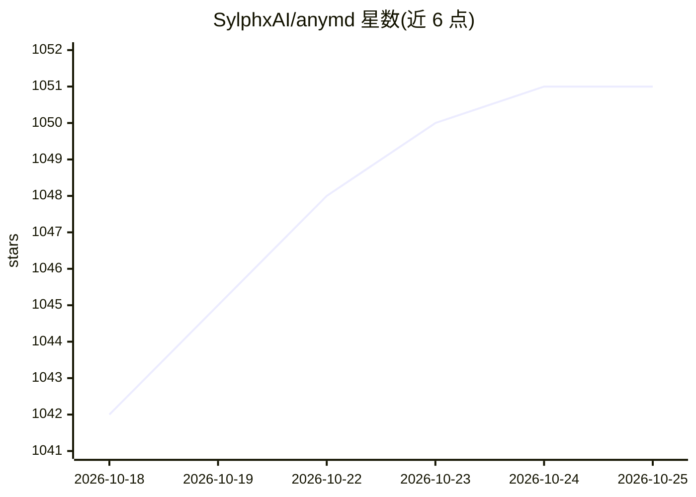

# SylphxAI/anymd

⭐ 1,052 · Rust · MIT · 推送 2026-10-25 · [GitHub](https://github.com/SylphxAI/anymd) · [官网](https://sylphxai.github.io/anymd/) · 组织维护

**本地多格式文档转 Markdown 的 Rust MCP 服务器与 CLI**

Rust 编写的 MCP 服务器兼命令行工具，将 PDF、Word、PPT、Excel、EPUB、HTML/网页、图片（OCR）、音视频（元数据/字幕/转写）转换为面向 AI agent 的 Markdown，本地运行、无需 API key。PDF 解析基于字形位置重建阅读顺序与表格；OCR 可用本地 doc-VLM 模型或 tesseract，转写用 ffmpeg 与捆绑的 Qwen3-ASR（需显式选择下载）。提供 outline/read/search/inspect 四个 MCP 工具，token 预算与游标控制大文档上下文。安装途径含 npm、PyPI、brew、winget、Docker 及 cargo 编译，另有托管付费模式 anymd Pro。

## 筛选速览

| 维度 | 判定 | 备注 |
|---|---|---|
| AI 角色 | `ai-ecosystem` | LLM/agent 周边工具 |
| 许可风险 | `permissive` | MIT |
| 部署形态 | `self-host` | docker 或自建部署 |
| 模型依赖 | — | README 未给出锁定关系 |
| 硬件要求 | — | 无带数字的原话,不猜 |
| 安装摩擦 | `low` | 无编译、无系统依赖或容器化 |
| 成熟度 | — | 结构信号不足 |

## 能力要点

- 单一 read 工具覆盖全部格式，支持 URL 与目录，search 跨文件检索（无精确命中时回退 BM25）
- PDF 按字形位置重建阅读顺序与表格，含无边框表格；页级并行处理
- 本地运行，OCR 用本地 doc-VLM 或 tesseract，ASR 用捆绑 Qwen3-ASR，不上传数据
- 一条 npx 命令接入 Claude Code、Codex、Cursor、VS Code 等 MCP 客户端

## 适用场景

- 让编程 agent 或 MCP 客户端直接读取 PDF/Office/网页等文档作答
- 批量把本地文件转换为 Markdown 供知识库或 RAG 使用
- 在多个文档目录中检索内容并附引用页码

## 场景标签

`文档解析` `OCR` · 领域:知识与检索

## 证据(README 行号)

> L5: PDF, Word, PowerPoint, Excel, EPUB, HTML and web pages, images (OCR), audio and video (metadata, subtitles, transcri
> L40: Add anymd to every MCP client on your machine (Claude Code, Codex, Cursor, VS Code, Claude Desktop, Windsurf, Gemin
> L167: anymd exposes four tools.

## 星数曲线

2026-10-18 1,042 → 2026-10-25 1,051（+9）

---
*卡片 v1 · prompt 1.4 · 生成 2026-10-21 · 置信度 high · 依据 README sha `9fe7ecbf52c4` · [字段定义](../../DATASET.md)*
