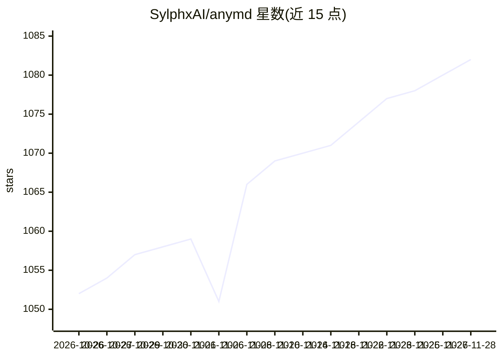

# SylphxAI/anymd

⭐ 1,082 · Rust · MIT · 推送 2026-11-27 · [GitHub](https://github.com/SylphxAI/anymd) · [官网](https://anymd.sylphx.com) · 组织维护

**给 AI agent 的文档转 Markdown 工具：本地运行的 Rust MCP 服务器和 CLI**

以 Rust 实现的 MCP 服务器与 CLI，将 PDF、Word、PowerPoint、Excel、EPUB、HTML/网页、图片、音视频转为 Markdown，供 agent 通过 outline/read/search/inspect 四个工具读取；含版面重建、引用锚点、token 预算与分页，OCR 走本地 doc-VLM 或 tesseract，转录用 ffmpeg 与捆绑的 Qwen3-ASR，全部本地处理无需 API key。面向需要让 agent 读取本地文档的开发者；付费 Pro 版提供 PDF 引文核验与视频帧引用。

## 筛选速览

| 维度 | 判定 | 备注 |
|---|---|---|
| AI 角色 | `ai-ecosystem` | LLM/agent 周边工具 |
| 许可风险 | `permissive` | MIT |
| 部署形态 | `self-host` | docker 或自建部署 |
| 模型依赖 | — | README 未给出锁定关系 |
| 硬件要求 | — | 无带数字的原话,不猜 |
| 安装摩擦 | `low` | 无编译、无系统依赖或容器化 |
| 成熟度 | — | 结构信号不足 |

## 能力要点

- 一个 read 工具覆盖所有格式，接受文件、URL 与目录
- 版面引擎恢复阅读顺序与表格（含无边框表），输出带引用锚点
- token 预算与 cursor 分页控制大文档上下文
- 本地 OCR（doc-VLM/tesseract）与本地 ASR（Qwen3-ASR），不上传数据

## 适用场景

- 让 Claude Code/Cursor 等 agent 直接读取本地 PDF 与 Office 文档
- 把一批论文/报告批量转成 Markdown 供检索
- 给网页文章提取正文并转为干净 Markdown
- 本地离线转录音视频字幕

## 场景标签

`文档解析` · 领域:知识与检索

## 证据(README 行号)

> L1: anymd — any file → clean Markdown for AI agents
> L5: PDF, Word, PowerPoint, Excel, EPUB, HTML and web pages, images (OCR), audio and video (metadata, subtitles, transcri
> L191: ## MCP tools

## 星数曲线

2026-10-26 1,052 → 2026-11-28 1,082（+30）

---
*卡片 v1 · prompt 1.4 · 生成 2026-11-28 · 置信度 high · 依据 README sha `37c11e725093` · [字段定义](../../DATASET.md)*
