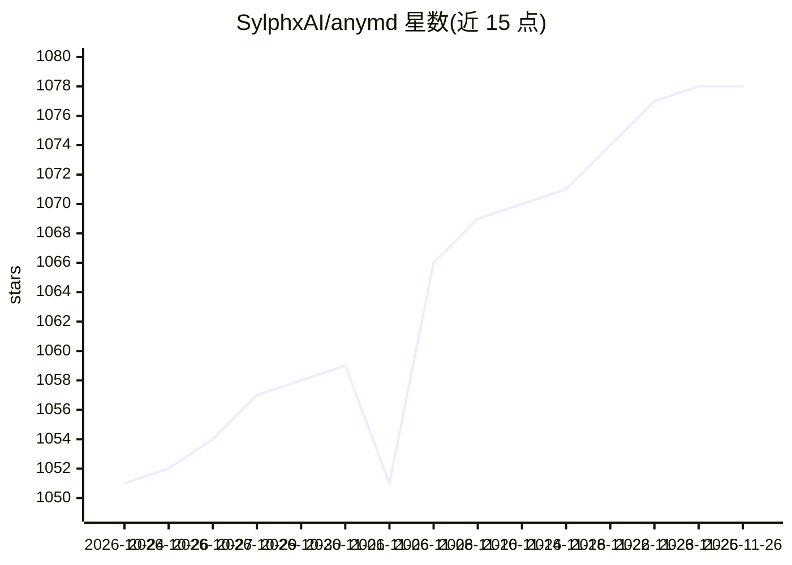

# SylphxAI/anymd

⭐ 1,078 · Rust · MIT · 推送 2026-11-25 · [GitHub](https://github.com/SylphxAI/anymd) · [官网](https://anymd.sylphx.com) · 组织维护

**给 AI agent 的本地文档转 Markdown 工具：Rust MCP 服务器与 CLI**

基于 Rust 的文档转 Markdown 工具，以 MCP 服务器和 CLI 两种形态运行在本地，无需 API key。支持 PDF、Word、PowerPoint、Excel、EPUB、HTML/网页、图片（OCR）、音视频（元数据、字幕、转录）。提供 outline/read/search/inspect 四个 MCP 工具，read 支持分页、token 预算与引用锚点，search 在无精确匹配时回退 BM25 排序。OCR 使用本地 doc-VLM 模型或 tesseract，转录使用 ffmpeg 与内置 Qwen3-ASR，均需显式 opt-in。提供 npm、PyPI、Homebrew、crates.io、Docker 安装途径。

## 筛选速览

| 维度 | 判定 | 备注 |
|---|---|---|
| AI 角色 | `ai-ecosystem` | LLM/agent 周边工具 |
| 许可风险 | `permissive` | MIT |
| 部署形态 | `self-host` | docker 或自建部署 |
| 模型依赖 | — | README 未给出锁定关系 |
| 硬件要求 | — | 无带数字的原话,不猜 |
| 安装摩擦 | `low` | 无编译、无系统依赖或容器化 |
| 成熟度 | — | 结构信号不足 |

## 能力要点

- 四种格式类别统一转 Markdown：文档/网页/图片 OCR/音视频字幕与转录
- MCP 服务器一条命令接入 Claude Code、Codex、Cursor、VS Code 等客户端
- 本地运行不上传数据，OCR 与 ASR 模型需显式 opt-in 下载
- read 工具带 token 预算、游标分页与引用锚点，search 回退 BM25 排序

## 适用场景

- 把 PDF、Office 文档批量转成 Markdown 供 agent 读取
- 在本地对文档目录做全文检索并返回带页码的命中
- 为音视频文件提取字幕或生成本地转录

## 场景标签

`文档解析` · 领域:知识与检索

## 证据(README 行号)

> L5: PDF, Word, PowerPoint, Excel, EPUB, HTML and web pages, images (OCR), audio and video (metadata, subtitles, transcri
> L26: npx -y @sylphx/anymd setup                                    # add anymd to every MCP client on this machine
> L191: ## MCP tools

## 星数曲线

2026-10-24 1,051 → 2026-11-26 1,078（+27）

---
*卡片 v1 · prompt 1.4 · 生成 2026-11-26 · 置信度 high · 依据 README sha `b56f7bd3d5e9` · [字段定义](../../DATASET.md)*
