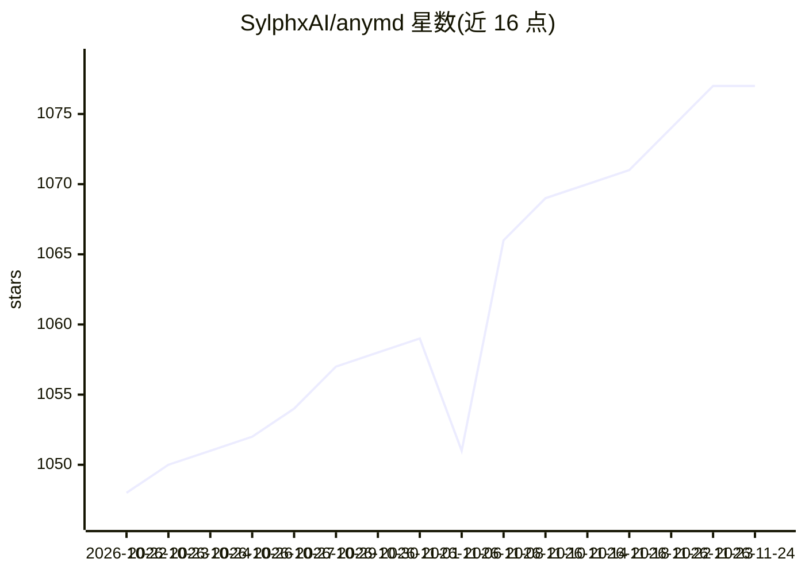

# SylphxAI/anymd

⭐ 1,077 · Rust · MIT · 推送 2026-11-22 · [GitHub](https://github.com/SylphxAI/anymd) · [官网](https://anymd.sylphx.com) · 组织维护

**给 AI agent 的本地文档转 Markdown 工具：Rust MCP 服务器与 CLI**

以 Rust 实现的 MCP 服务器与命令行工具，在本地将 PDF、Word、PowerPoint、Excel、EPUB、HTML/网页、图片（OCR）、音视频（元数据、字幕、转录）转换为 Markdown，无需 API key。提供 outline/read/search/inspect 四个 MCP 工具，支持 token 预算与游标分页；OCR 可用本地 doc-VLM 或 tesseract，转录用 ffmpeg 与内置 Qwen3-ASR（需显式 opt-in）。另有付费 Pro 功能：PDF 引文核验与视频帧引用。可通过 npx 一键接入主流 MCP 客户端。

## 筛选速览

| 维度 | 判定 | 备注 |
|---|---|---|
| AI 角色 | `ai-ecosystem` | LLM/agent 周边工具 |
| 许可风险 | `permissive` | MIT |
| 部署形态 | `self-host` | docker 或自建部署 |
| 模型依赖 | — | README 未给出锁定关系 |
| 硬件要求 | — | 无带数字的原话,不猜 |
| 安装摩擦 | `low` | 无编译、无系统依赖或容器化 |
| 成熟度 | — | 结构信号不足 |

## 能力要点

- 多种文档格式统一转 Markdown，支持文件、URL 与整个目录
- 四个 MCP 工具：outline/read/search/inspect，read 支持 max_tokens 分页与引用锚点
- 本地运行不上传数据，OCR/ASR 均可本地完成
- 提供 open benchmark（AgentDocBench）及与其他转换工具的同跑对比数据

## 适用场景

- 让 Claude Code/Cursor 等 MCP 客户端直接读取 PDF、Office 文档
- 批量把论文、幻灯片、表格转成 agent 可用的 Markdown 语料
- 在本地对文档目录做全文搜索并回传 BM25 排序的片段

## 场景标签

`文档解析` · 领域:知识与检索

## 证据(README 行号)

> L1: anymd — any file → clean Markdown for AI agents
> L5: PDF, Word, PowerPoint, Excel, EPUB, HTML and web pages, images (OCR), audio and video (metadata, subtitles, transcri
> L25: npx -y @sylphx/anymd setup                                    # add anymd to every MCP client on this machine

## 星数曲线

2026-10-22 1,048 → 2026-11-24 1,077（+29）

---
*卡片 v1 · prompt 1.4 · 生成 2026-11-24 · 置信度 high · 依据 README sha `3a8130b38ed9` · [字段定义](../../DATASET.md)*
