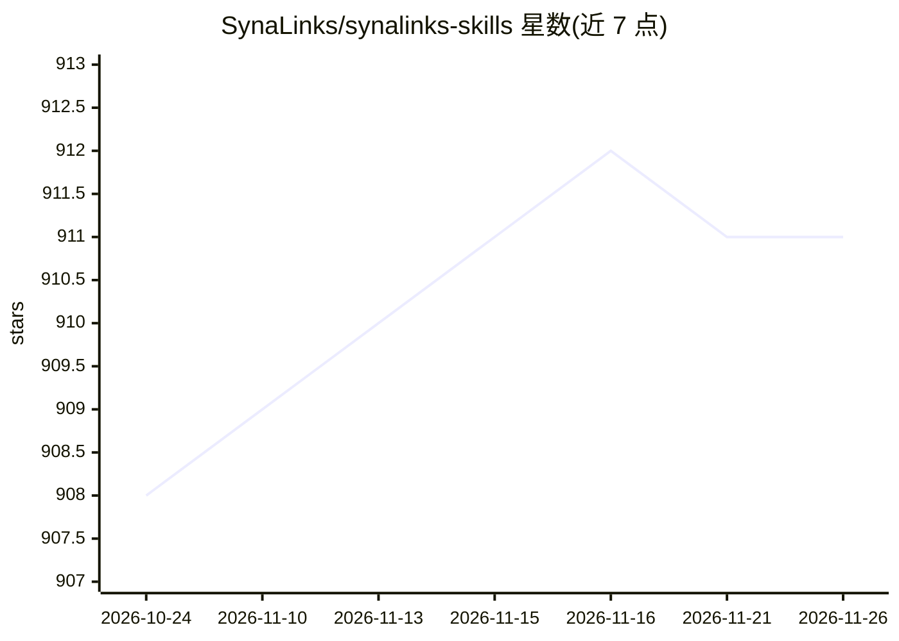

# SynaLinks/synalinks-skills

⭐ 911 · Python · Apache-2.0 · 推送 2026-11-17 · [GitHub](https://github.com/SynaLinks/synalinks-skills) · [官网](https://synalinks.github.io/synalinks/) · 组织维护

**教编码 Agent 正确使用 Synalinks 框架的 SKILL.md 技能包**

包含单一技能 synalinks 的仓库，以开放 SKILL.md 格式为编码 Agent 提供使用 Synalinks 框架的指导。背景：Synalinks 受 Keras 启发，无指导时语言模型易混入 Keras/LangChain/DSPy 语法产生破损代码，该技能将 Agent 约束到惯用用法。SKILL.md 按框架切片组织（Core/Programs/Modules/Agents/Knowledge/Training/Rewards/Optimizers 等），每节指向可运行脚本与参考文档。安装途径：Claude Code/Codex/OpenCode 插件、npx skills CLI（支持 70+ Agent）、Claude.ai 网页/Desktop 上传 .skill 包；提供 skills-lock.json 锁定内容哈希以复现安装，技能不做语义版本化，跟随 main 分支。

## 筛选速览

| 维度 | 判定 | 备注 |
|---|---|---|
| AI 角色 | `ai-knowledge` | 知识聚合/清单类 |
| 许可风险 | `permissive` | Apache-2.0 |
| 部署形态 | `library` | 以包/库形式分发 |
| 模型依赖 | — | README 未给出锁定关系 |
| 硬件要求 | — | 无带数字的原话,不猜 |
| 安装摩擦 | `low` | 无编译、无系统依赖或容器化 |
| 成熟度 | — | 结构信号不足 |

## 能力要点

- 单一 synalinks 技能覆盖整个框架，按切片组织并附可运行脚本与运行日志
- Agent 依据 SKILL.md description 字段自动激活，无需手动选择
- skills-lock.json 记录 SHA-256 内容哈希，保证团队与 CI 内容一致
- 三种安装途径：插件市场、npx skills CLI（70+ Agent）、Claude.ai/Desktop 归档上传

## 适用场景

- 在写 Synalinks 代码的项目里让 Agent 遵循惯用语法
- 用 Claude Code、Cursor、Gemini CLI 等编码 Agent 开发 Synalinks 应用
- 团队与 CI 需要锁定相同技能内容时使用 lockfile

## 场景标签

`编码 Agent` · 领域:编码与开发

## 证据(README 行号)

> L5: This repository contains skills for coding agents that read the open Agent
> L29: Agent Skills are reusable instructions, in a plain `SKILL.md` file, that teach a
> L36: The goal of Synalinks skills is to teach coding agents to use the Synalinks

## 星数曲线

2026-10-24 908 → 2026-11-26 911（+3）

---
*卡片 v1 · prompt 1.4 · 生成 2026-11-24 · 置信度 high · 依据 README sha `b24d1df7e87c` · [字段定义](../../DATASET.md)*
