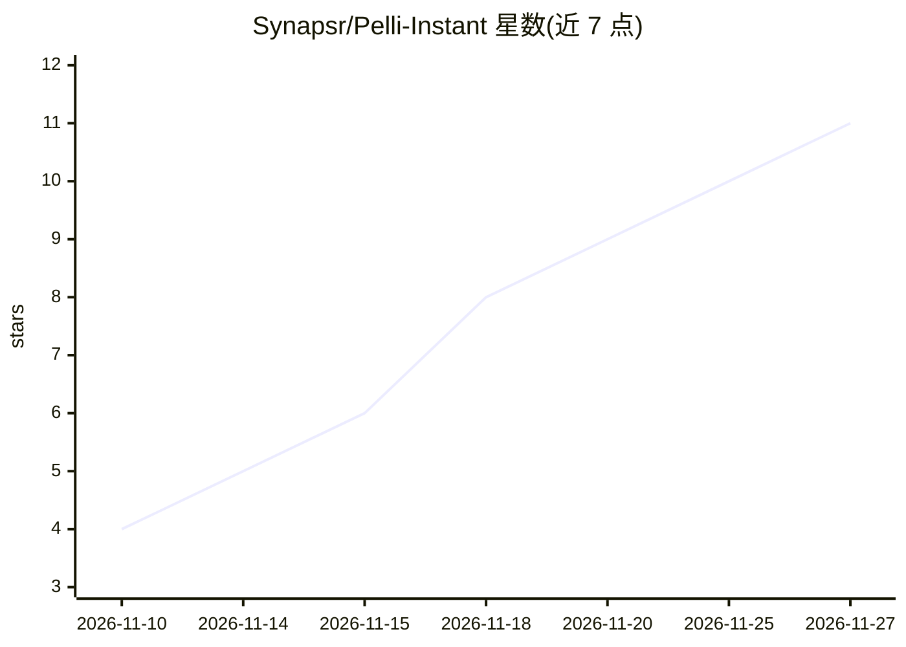

# Synapsr/Pelli-Instant

⭐ 11 · Rust · MIT · 推送 2026-11-26 · [GitHub](https://github.com/Synapsr/Pelli-Instant) · [官网](https://pelli.io) · 组织维护

**摄影师的本地 AI 选片工具：自动剔除糊片闭眼与重复**

面向摄影师的桌面选片应用，覆盖 macOS（Apple Silicon）与 Windows，基于 Tauri 2 构建，MIT 许可开源。将 RAW 或 JPEG 文件夹拖入后，本地运行 ONNX 模型检测失焦、运动模糊、闭眼、曝光偏差与重复/连拍，将照片分为 Selected、To review、Rejected 三组；支持键盘复核（用户决定优先于 AI 判定）、导出星标与色标到 Lightroom/Capture One/Bridge/darktable 的 XMP、复制选片或归档废片。基础功能免费无账号、100% 本地离线；付费 Plus（一次性 25 美元/欧元）提供更大模型的最大精度、AI 语义搜索与详细统计。可选将选片发送至 Pelli 画廊（需 Pelli 账号）。

## 筛选速览

| 维度 | 判定 | 备注 |
|---|---|---|
| AI 角色 | `ai-native` | 本体是模型或模型工具 |
| 许可风险 | `permissive` | MIT |
| 部署形态 | `desktop` | 安装包/桌面程序 |
| 模型依赖 | — | README 未给出锁定关系 |
| 硬件要求 | — | 无带数字的原话,不猜 |
| 安装摩擦 | `low` | 无编译、无系统依赖或容器化 |
| 成熟度 | — | 结构信号不足 |

## 能力要点

- 本地 ONNX Runtime 推理：Apple Silicon 用 CPU，Windows 用 DirectML 加速，离线可用
- 检测失焦、运动模糊、闭眼、曝光偏差、连拍与重复，并给出逐项拒绝理由
- 导出星标/色标/Pick 标志到 XMP，兼容 Lightroom、Capture One、Bridge、darktable
- 连拍分组、三种敏感度切换即时重排、支持 Canon/Nikon/Sony/Fujifilm 等多种 RAW 格式

## 适用场景

- 婚礼或活动拍摄后快速筛选上千张照片
- 批量剔除闭眼、失焦和重复镜头再进 Lightroom 修图
- 向客户交付前整理选片并生成画廊

## 场景标签

 · 领域:摄影/图像工具

## 证据(README 行号)

> L6: Drop a shoot: blurry shots, closed eyes and duplicates are set aside, the best photos are kept. About 1,000 photos i
> L28: - **100 % local.** The AI models run on your computer with ONNX Runtime, on the processor of Apple Silicon Macs (th
> L31: Pelli Instant is made by the team behind Pelli, the platform where photographers deliver and sell their work. The a

## 星数曲线

2026-11-10 4 → 2026-11-27 11（+7）

---
*卡片 v1 · prompt 1.4 · 生成 2026-11-20 · 置信度 mid · 依据 README sha `df2fac45e169` · [字段定义](../../DATASET.md)*
