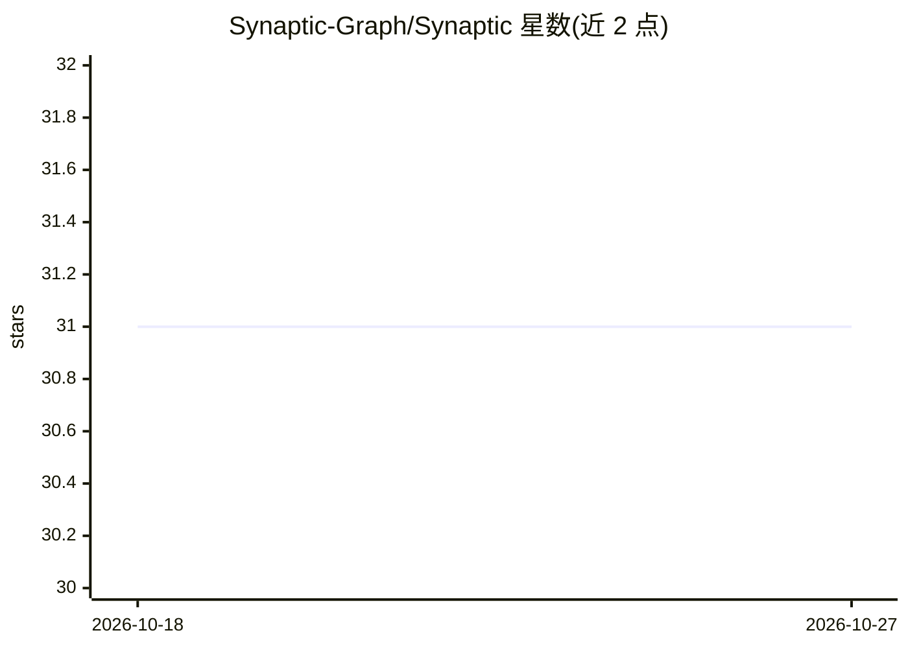

# Synaptic-Graph/Synaptic

⭐ 31 · Rust · AGPL-3.0 · 推送 2026-10-25 · [GitHub](https://github.com/Synaptic-Graph/Synaptic) · [官网](synapticgraph.com) · 个人维护

**给编程助手用的代码库知识图谱工具：依赖映射与变更影响分析**

以单个 Rust 二进制形式提供的代码智能工具：对仓库做一次本地确定性抽取，生成持久化、基于源码的知识图谱，覆盖符号、调用、导入、继承、SQL 与跨语言边界。通过 CLI 或 MCP 服务器供编程助手（Claude Code、Codex CLI、Cursor 等）调用，支持影响追踪、变更风险预测、测试选择、隔离 worktree 验证与仓库历史记忆。无需运行时、数据库、账号或 API key，默认离线；另有可选桌面应用 synaptic-ui 与另行维护的闭源 Synaptic Cloud 服务。AGPL-3.0-or-later 许可。

## 筛选速览

| 维度 | 判定 | 备注 |
|---|---|---|
| AI 角色 | `ai-ecosystem` | LLM/agent 周边工具 |
| 许可风险 | `viral` | AGPL-3.0 |
| 部署形态 | `library` | 以包/库形式分发 |
| 模型依赖 | — | README 未给出锁定关系 |
| 硬件要求 | — | 无带数字的原话,不猜 |
| 安装摩擦 | `low` | 无编译、无系统依赖或容器化 |
| 成熟度 | — | 结构信号不足 |

## 能力要点

- 单个 Rust 二进制，本地确定性抽取，无需运行时/数据库/API key
- CLI 与 MCP 服务器双通道，支持 Claude Code、Codex、Cursor 等助手接入
- 变更影响追踪、风险预测、测试选择与隔离 worktree 验证
- 支持数十种语言、增量更新与多仓库联邦，可导出 GraphML/Cypher/Graphviz 等格式

## 适用场景

- 让编程助手基于代码图谱回答架构与依赖问题，而非整读源文件
- 改动前预测影响范围并选出应跑的测试
- 在隔离 worktree 中验证重构方案后再合并

## 场景标签

`知识图谱` · 领域:知识与检索

## 证据(README 行号)

> L11: The answers come from a persistent, source-grounded knowledge graph, available from the CLI
> L54: Claude and Codex load only a small set of tools at startup, then find the rest on demand. This
> L104: |`synaptic serve`|Run the MCP server|

## 星数曲线

2026-10-18 31 → 2026-10-27 31（+0）

---
*卡片 v1 · prompt 1.4 · 生成 2026-10-26 · 置信度 high · 依据 README sha `4c67dfd847e9` · [字段定义](../../DATASET.md)*
